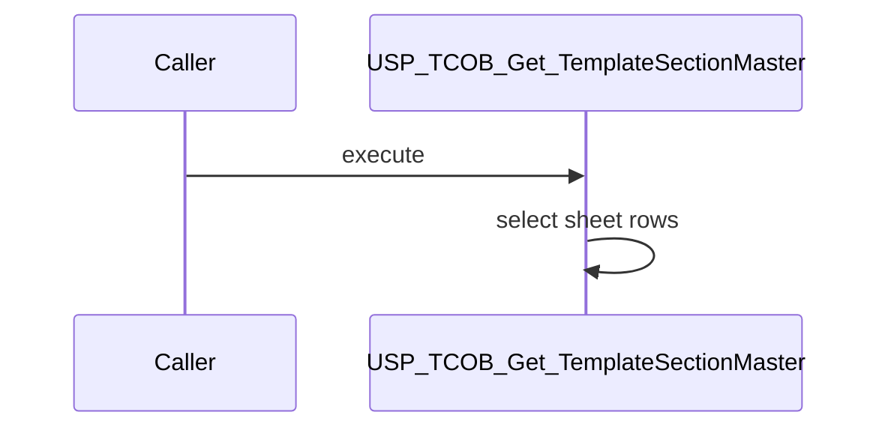
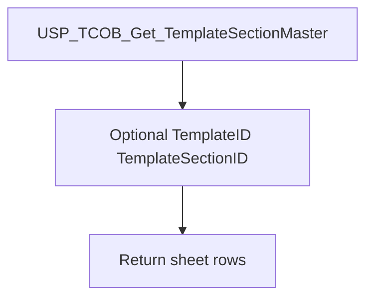

# USP_TCOB_Get_TemplateSectionMaster

## What it does

Returns Config Manager sheet rows from `TCOB_TemplateSectionMaster`, optionally filtered by template id and/or template-section id. Includes `Json_ConfigPath` and `DisplayOrder`.

## Parameters

| Name | Type | Direction | Default | Meaning |
|---|---|---|---|---|
| `@TemplateID` | INT | in | NULL | Filter by template |
| `@TemplateSectionID` | INT | in | NULL | Filter by sheet |

## Call sequence

Calls no other procedures or functions.

## Callers

Procedures and functions that call this object.

No other procedure or function calls this object. App caller: `ClientOnboardingDAL.getTCOBTemplateSections` from Config Manager (`GET /api/clientonboard2/cfg/getTemplateSections`) and nested from `generateCOBConfigFile`.

## Nested

| Object | Kind | When | Page |
|---|---|---|---|
| *(none)* | — | — | — |

## Steps

1. Script is `HRMS-DATABASE/HRMS/STOREPROCEDURE/USP_TCOB_Get_TemplateSectionMaster.sql`.
2. Select sheet columns with optional filters; order by `TemplateSectionID`.

## Tables

| Table | Read or write |
|---|---|
| `dbo.TCOB_TemplateSectionMaster` | read |

## Unresolved calls

None.

## Flow

