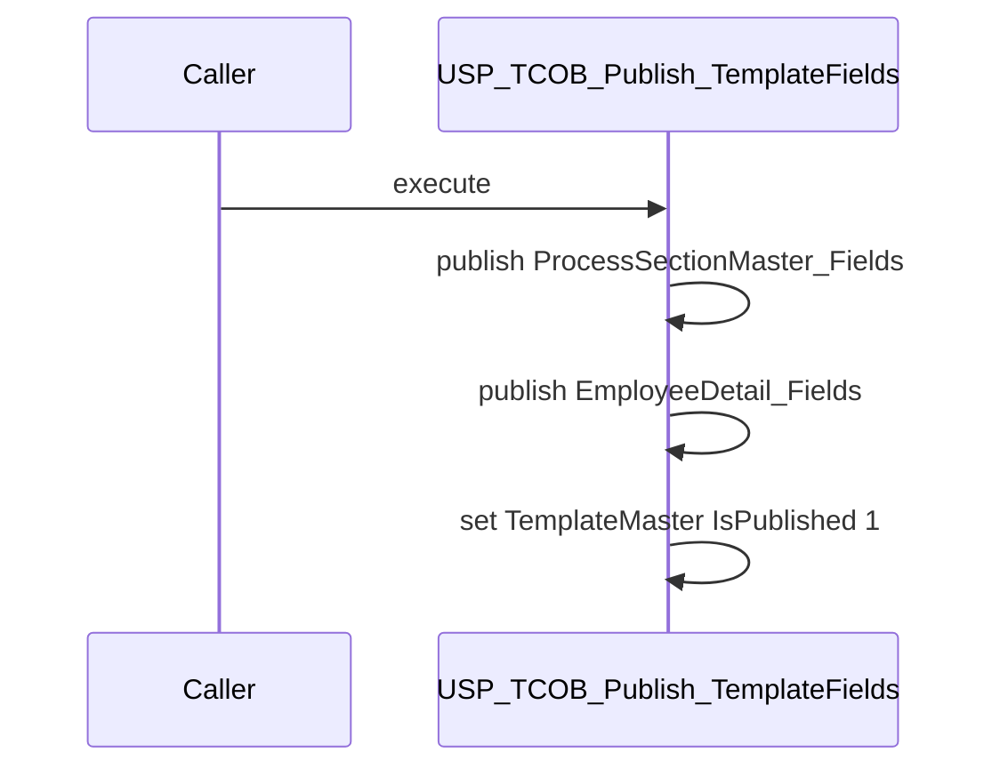
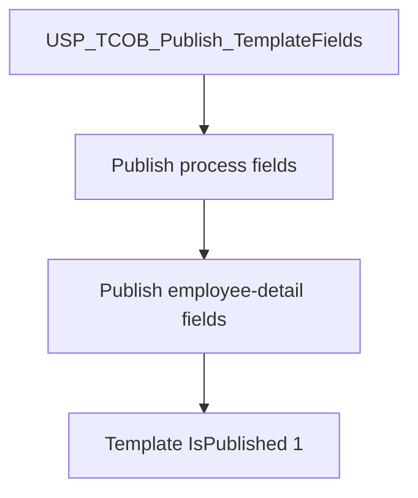

# USP_TCOB_Publish_TemplateFields

## What it does

Marks unpublished active fields for one workbook template as published, then sets `TCOB_TemplateMaster.IsPublished = 1`. Updates both `TCOB_ProcessSectionMaster_Fields` and `TCOB_EmployeeDetail_Fields` joined through the template’s sheets and datasets.

## Parameters

| Name | Type | Direction | Default | Meaning |
|---|---|---|---|---|
| `@TemplateID` | INT | in | — | Template to publish |
| `@EmployeeID` | INT | in | — | Audit user |

## Call sequence

Calls no other procedures or functions.

## Callers

Procedures and functions that call this object.

No other procedure or function calls this object. App caller: `ClientOnboardingDAL.publishTCOBTemplateFields` nested from Config Manager `generateCOBConfigFile` (`POST /api/clientonboard2/cfg/generateCOBConfigFile`).

## Nested

| Object | Kind | When | Page |
|---|---|---|---|
| *(none)* | — | — | — |

## Steps

1. Script is `HRMS-DATABASE/HRMS/STOREPROCEDURE/USP_TCOB_Publish_TemplateFields.sql`.
2. Set `IsPublished = 1` on unpublished active process-section fields for the template.
3. Same for employee-detail fields linked via `EmployeeDetailSectionID`.
4. Set template `IsPublished = 1`.

## Tables

| Table | Read or write |
|---|---|
| `dbo.TCOB_ProcessSectionMaster_Fields` | write |
| `dbo.TCOB_ProcessSectionMaster` | read |
| `dbo.TCOB_TemplateSectionMaster` | read |
| `dbo.TCOB_EmployeeDetail_Fields` | write |
| `dbo.TCOB_TemplateMaster` | write |

## Unresolved calls

None.

## Flow

