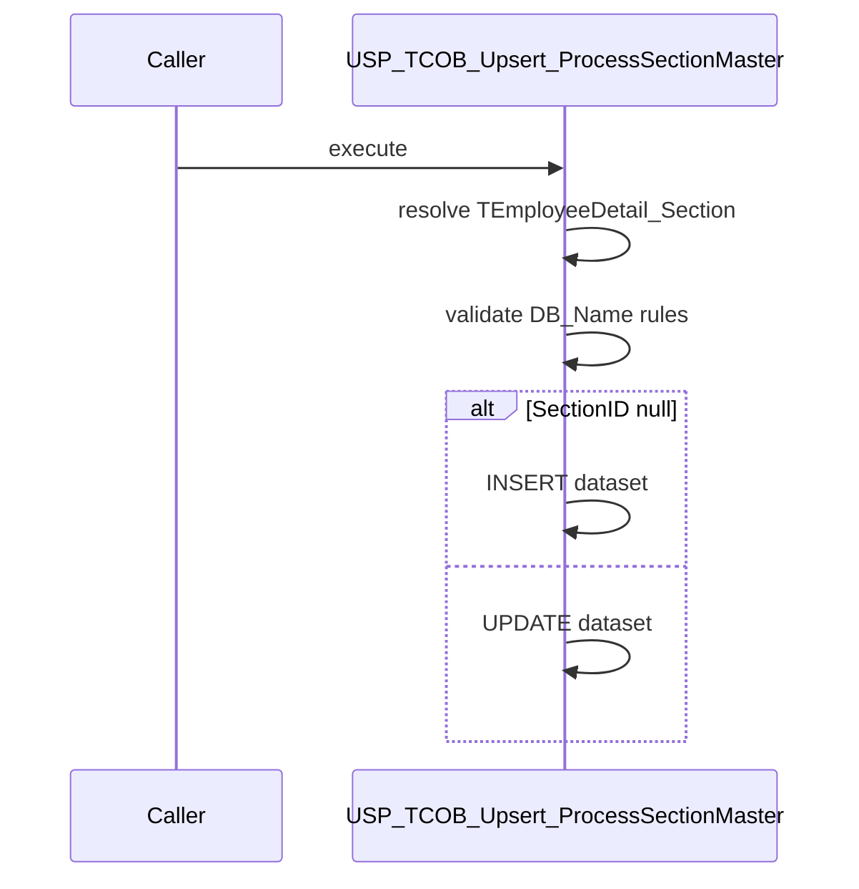
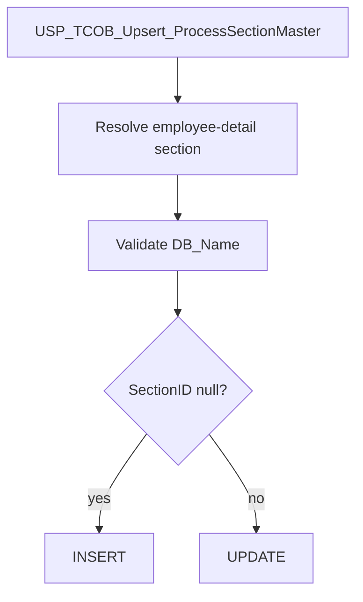

# USP_TCOB_Upsert_ProcessSectionMaster

## What it does

Inserts or updates one Config Manager dataset in `TCOB_ProcessSectionMaster`. Resolves `EmployeeDetailSectionID` from `TEmployeeDetail_Section` by section name. Supports optional cross-database `DB_Name` (null = leave alone; empty string = clear; same as current DB name treated as local). Refuses employee-detail datasets targeting another database, and refuses changing `DB_Name` when fields already point at tables.

## Parameters

| Name | Type | Direction | Default | Meaning |
|---|---|---|---|---|
| `@SectionID` | INT | in | NULL | NULL = insert |
| `@TemplateID` | INT | in | — | Parent template |
| `@TemplateSectionID` | INT | in | — | Parent sheet |
| `@Section` | NVARCHAR(500) | in | — | Dataset name |
| `@Tab_Page` | NVARCHAR(200) | in | — | UI tab label |
| `@IsActive` | BIT | in | 1 | Active flag |
| `@IsMasterData` | BIT | in | NULL | Master-data flag |
| `@SectionDataType` | NVARCHAR(100) | in | NULL | Data-type label |
| `@IsMandatory` | BIT | in | NULL | Mandatory flag |
| `@DisplayOrder` | INT | in | NULL | Sort order |
| `@StoredProcName` | NVARCHAR(500) | in | USP_COB_MasterProcessor | Process SP name |
| `@ProcessMasterExist_SQL` | NVARCHAR(MAX) | in | NULL | Existence SQL |
| `@EmployeeID` | INT | in | — | Audit user |
| `@IsClientDefaultMasterData` | BIT | in | 0 | OTD default flag |
| `@ModuleId` | INT | in | — | Module |
| `@IsClientOnboardingData` | BIT | in | 0 | COB import flag |
| `@IsIndustryScoped` | BIT | in | NULL | NULL = leave alone on update |
| `@DB_Name` | SYSNAME | in | NULL | Cross-DB target; NULL = leave |

## Call sequence

Calls no other procedures or functions.

## Callers

Procedures and functions that call this object.

No other procedure or function calls this object. App caller: `ClientOnboardingDAL.upsertTCOBProcessSectionMaster` from Config Manager (`POST /api/clientonboard2/cfg/upsertProcessSectionMaster`).

## Nested

| Object | Kind | When | Page |
|---|---|---|---|
| *(none)* | — | — | — |

## Steps

1. Script is `HRMS-DATABASE/HRMS/STOREPROCEDURE/USP_TCOB_Upsert_ProcessSectionMaster.sql`.
2. Match employee-detail section by name; validate `DB_Name` against employee-detail and existing fields.
3. Insert or update `TCOB_ProcessSectionMaster`.

## Tables

| Table | Read or write |
|---|---|
| `dbo.TEmployeeDetail_Section` | read |
| `dbo.TCOB_ProcessSectionMaster` | read + write |
| `dbo.TCOB_ProcessSectionMaster_Fields` | read (guard) |

## Unresolved calls

None.

## Flow

