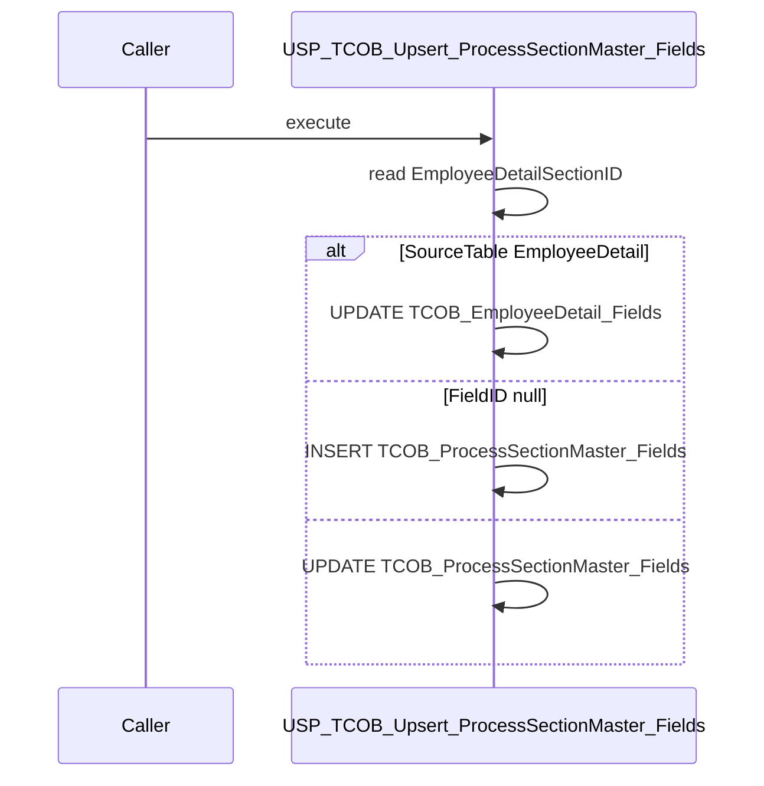
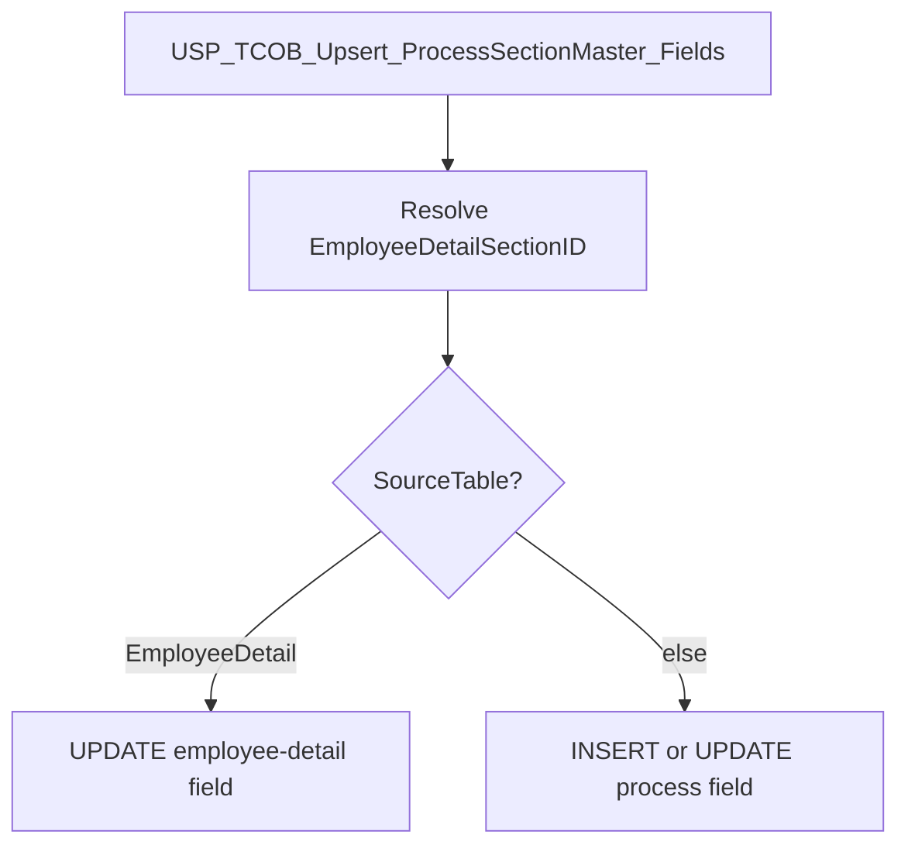

# USP_TCOB_Upsert_ProcessSectionMaster_Fields

## What it does

Inserts or updates Config Manager field definitions for a process section. When `@SourceTable = 'EmployeeDetail'` and `@FieldID` is set, it updates `TCOB_EmployeeDetail_Fields`. Otherwise it inserts/updates `TCOB_ProcessSectionMaster_Fields`. Updates reset `IsPublished` to 0 so the template must be republished.

## Parameters

| Name | Direction | What it is for |
|---|---|---|
| `@SectionID` | in | Parent process section |
| `@FieldName` | in | Field key |
| `@DisplayText` | in | Grid / workbook column label |
| `@DisplayOrder` | in | Order |
| `@IsMandatory` / `@IsDefault` / `@IsHidden` | in | Field flags |
| `@DB_Schema` / `@DB_Table` / `@DB_Column` | in | Target mapping |
| `@DB_Column_Encrypted` / `@DB_IsIdentity` / `@DB_IsUnique` | in | Column metadata |
| `@Length` / `@Format` | in | Length and format |
| `@FieldTypeID` / `@FieldType_JSON_SQL` | in | Field type and lookup SQL |
| `@IsValidate` / `@ValidationRule` / `@TransformationRule` | in | Validation rules |
| `@Masked` / `@DependOnField` / `@IsLocked` | in | UI / lock flags |
| `@FieldID` | in | NULL insert (process path); set for update |
| `@SourceTable` | in | `EmployeeDetail` vs process field path |
| `@EmployeeID` | in | Audit user |

## Call sequence

Calls no other procedures or functions.

## Callers

Procedures and functions that call this object.

No other procedure or function calls this object. App caller: `ClientOnboardingDAL.upsertTCOBProcessSectionMasterFields` from Config Manager (`POST /api/clientonboard2/cfg/upsertProcessSectionMasterFields`).

## Nested

| Object | Kind | When | Page |
|---|---|---|---|
| *(none)* | — | — | — |

## Steps

1. Script is `HRMS-DATABASE/HRMS/STOREPROCEDURE/USP_TCOB_Upsert_ProcessSectionMaster_Fields.sql`.
2. Resolve `EmployeeDetailSectionID` from `TCOB_ProcessSectionMaster`.
3. If `@SourceTable = 'EmployeeDetail'` and `@FieldID` set, update `TCOB_EmployeeDetail_Fields` and clear publish.
4. Else insert or update `TCOB_ProcessSectionMaster_Fields` (insert when `@FieldID` is null).

## Tables

| Table | Read or write |
|---|---|
| `dbo.TCOB_ProcessSectionMaster` | read |
| `dbo.TCOB_EmployeeDetail_Fields` | write |
| `dbo.TCOB_ProcessSectionMaster_Fields` | write |

## Unresolved calls

None.

## Flow

