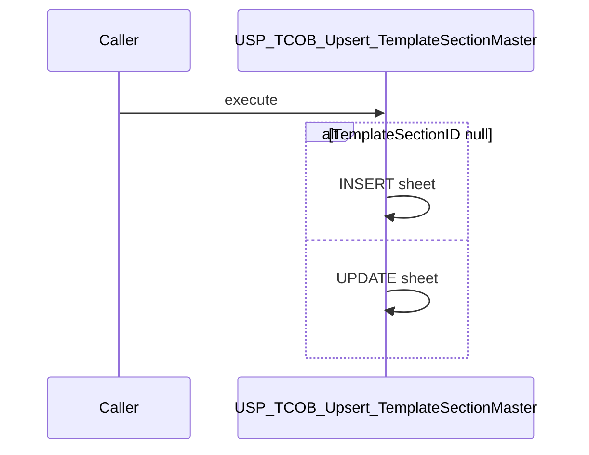
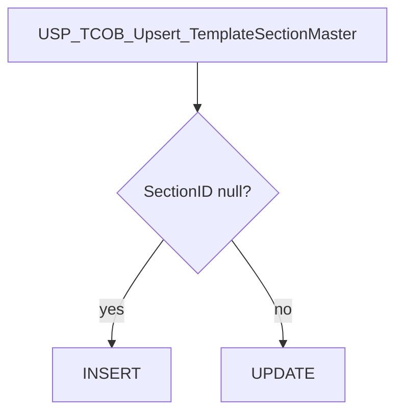

# USP_TCOB_Upsert_TemplateSectionMaster

## What it does

Inserts or updates one Config Manager sheet (`TCOB_TemplateSectionMaster`). Null `@TemplateSectionID` inserts; otherwise updates name, active flag, `Json_ConfigPath`, and `DisplayOrder`.

## Parameters

| Name | Type | Direction | Default | Meaning |
|---|---|---|---|---|
| `@TemplateSectionID` | INT | in | NULL | NULL = insert |
| `@TemplateID` | INT | in | — | Parent template |
| `@TemplateSection` | NVARCHAR(255) | in | — | Sheet name |
| `@IsActive` | BIT | in | — | Active flag |
| `@Json_ConfigPath` | NVARCHAR(1000) | in | NULL | Published config path |
| `@DisplayOrder` | INT | in | NULL | Sort order |
| `@EmployeeID` | INT | in | — | Audit user |

## Call sequence

Calls no other procedures or functions.

## Callers

Procedures and functions that call this object.

No other procedure or function calls this object. App caller: `ClientOnboardingDAL.upsertTCOBTemplateSectionMaster` from Config Manager (`POST /api/clientonboard2/cfg/upsertTemplateSectionMaster`).

## Nested

| Object | Kind | When | Page |
|---|---|---|---|
| *(none)* | — | — | — |

## Steps

1. Script is `HRMS-DATABASE/HRMS/STOREPROCEDURE/USP_TCOB_Upsert_TemplateSectionMaster.sql`.
2. Insert when `@TemplateSectionID` is null; otherwise update the matching sheet row.

## Tables

| Table | Read or write |
|---|---|
| `dbo.TCOB_TemplateSectionMaster` | write |

## Unresolved calls

None.

## Flow

