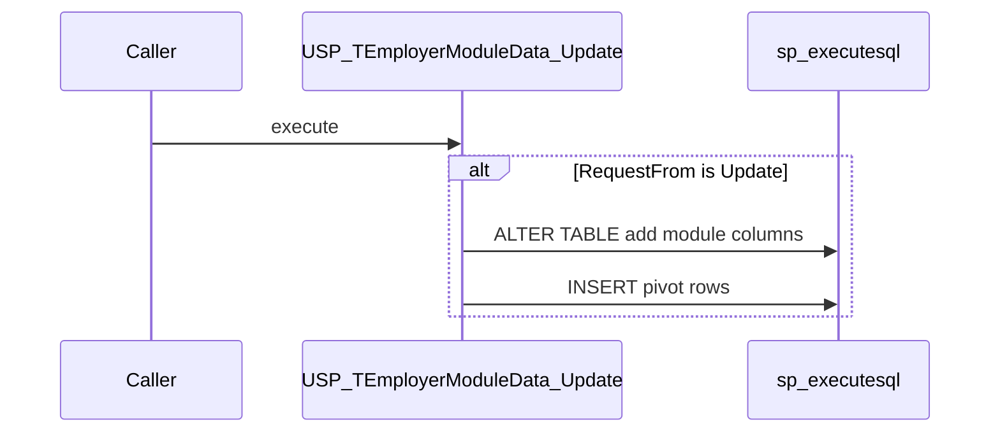
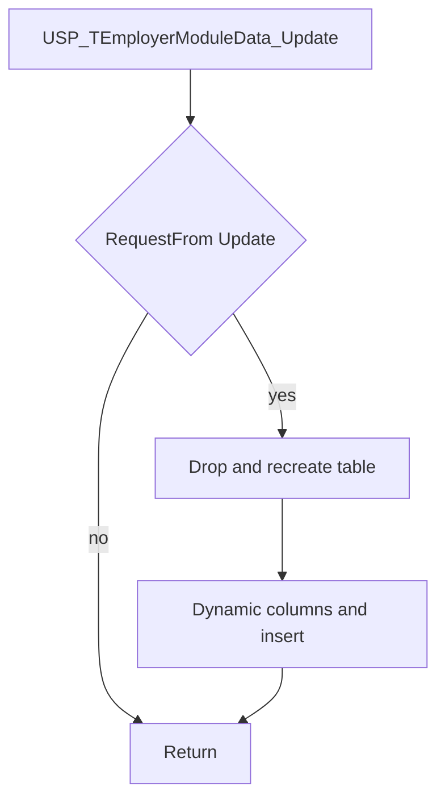

# USP_TEmployerModuleData_Update

## What it does

When `@RequestFrom` is `Update`, drops and recreates table `TEmployerModuleData` as a pivot of active `TEmployerModule` rows by module name (one column per `THrmsModules` name, 1 when the employer has that module).

## Parameters

| Name | Direction | What it is for |
|---|---|---|
| `@RequestFrom` | in | Must be `Update` for the body to run |

## Call sequence

## Callers

Called from `USP_TLicence_SaveUpdate` when `@RequestFrom` is null (passes `Update`).

## Nested

| Object | Kind | When | Page |
|---|---|---|---|
| `sp_executesql` | system | add pivot columns and insert pivoted rows | n/a |

## Steps

1. Return immediately unless `@RequestFrom = 'Update'`.
2. Drop and recreate `TEmployerModuleData` with `EmployerId`.
3. Dynamically add one `VARCHAR(200)` column per distinct `THrmsModules.ModuleName`.
4. Dynamically insert pivoted active employer-module access flags.

## Tables

| Table | Read or write |
|---|---|
| `dbo.TEmployerModuleData` | drop, create, write |
| `dbo.THrmsModules` | read |
| `dbo.TEmployerModule` | read |

## Unresolved calls

None beyond `sys.sp_executesql`.

## Flow

