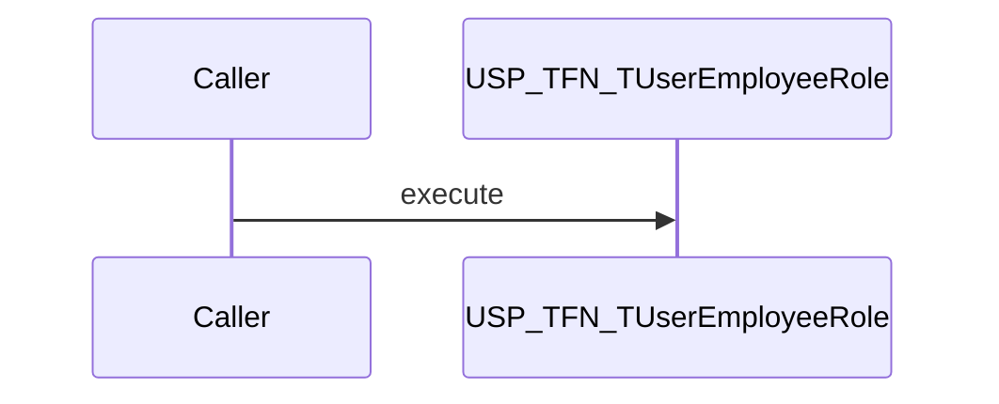
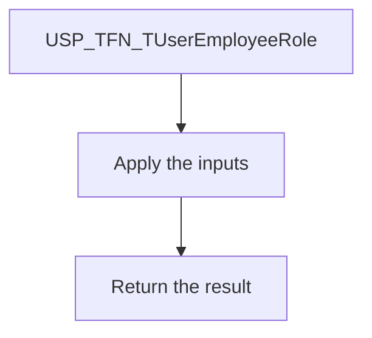

# USP_TFN_TUserEmployeeRole

## What it does

Helper called by a Home dashboard procedure. It reads TUserEmployee, TUsers, TRoles and returns that result to its caller.

## Parameters

| Name | Direction | What it is for |
|---|---|---|
| `@EmployeeId` | in | Employee the Home screen is loading or acting for (`INT`) |

## Call sequence

## Callers

| Object | Kind | Page |
|---|---|---|
| `SP_CheckIsEmployeeApprover` | procedure | [SP_CheckIsEmployeeApprover](/docs/database/hrms/SP_CheckIsEmployeeApprover) |
| `Sp_Geo_GetEmpTrackingByTripID_Opt` | procedure | No page yet |
| `Sp_Geo_GetEmpTrackingByTripID_OptV2` | procedure | No page yet |
| `Sp_Geo_GetEmpTrackLocationRports` | procedure | No page yet |
| `SP_GetEmployeeListByOrgAndBU` | procedure | No page yet |
| `Sp_RRS_GetCandidateShortListDetByShortListID` | procedure | No page yet |
| `SP_TNE_EmployeeAudit_ApplicablePolicies` | procedure | No page yet |
| `Sp_TnE_GetAllClaims` | procedure | No page yet |
| `SP_TNE_GetEmployeesDetailedBasedOnMultipleBU` | procedure | No page yet |
| `SP_TNE_PE_EmployeeAudit_AccessibleTypes` | procedure | No page yet |
| `SP_TNE_PE_EvaluateEligibilityPolicy` | procedure | No page yet |
| `SP_TNE_PE_EvaluateEligibilityPolicy_Batch` | procedure | No page yet |
| `SP_TNE_PE_EvaluatePolicy_Batch` | procedure | No page yet |
| `Sp_TnE_SearchEmployee` | procedure | No page yet |
| `UFN_GetPendingAccountantName` | function | No page yet |
| `UFN_TnE_GetPendingAccountantName` | function | No page yet |
| `USP_Download_EmployeeRosterTemplateData` | procedure | No page yet |
| `USP_Employee_List_By_Role` | procedure | No page yet |
| `USP_EmployeeAccessPermission_History_List` | procedure | No page yet |
| `USP_EmployeeAccessPermission_List` | procedure | No page yet |
| `USP_GeoTracking_EmployeeList` | procedure | No page yet |
| `USP_Get_ShiftRoasterDetails` | procedure | No page yet |
| `USP_InsertRecruitmentClaimIfNotExistForRecruiter` | procedure | No page yet |
| `USP_RRS_GetCandidateJoiningIntimiationStatus` | procedure | No page yet |

## Nested

This object does not execute another procedure or user-defined function.

## Steps

In `HRMS-DATABASE/HRMS/FUNCTIONS/USP_TFN_TUserEmployeeRole.sql`:

1. Read `TUserEmployee`, `TUsers`, `TRoles`.
2. Return the result set to the caller.

## Tables

| Table | Read or write |
|---|---|
| `TUserEmployee` | read |
| `TUsers` | read |
| `TRoles` | read |

## Flow

