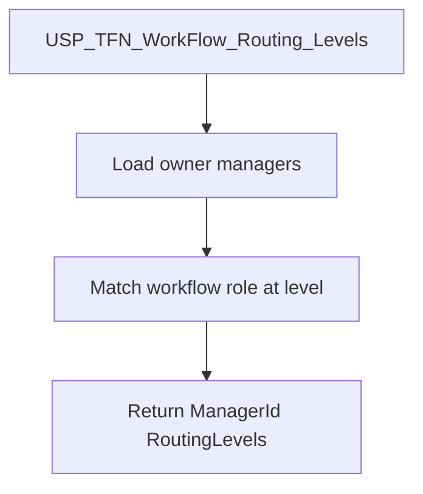

# USP_TFN_WorkFlow_Routing_Levels

## What it does

Table-valued function that returns manager ids for a workflow routing level (`ManagerId`, `RoutingLevels`) given workflow id, request owner, employer, optional request transaction id/type, and routing level. Distinct from procedure `USP_WorkFlow_Routing_Levels`. Used by expense stalled-request replay when advancing levels.

## Parameters

| Name | Direction | What it is for |
|---|---|---|
| `@wfId` | in | Workflow id |
| `@lv_RequestOwner` | in | Request owner employee |
| `@Employerid` | in | Employer |
| `@RequestTransid` | in | Optional request id |
| `@RequestType` | in | Optional request type |
| `@RoutingLevels` | in | Target routing level |

## Call sequence

Calls no other procedures. Resolves functional/reporting/BU-head style managers from employee and workflow detail tables inside the function.

## Callers

| Object | Kind | Page |
|---|---|---|
| `SP_TNE_ReplayStalledRequest` | procedure | [SP_TNE_ReplayStalledRequest](/docs/database/hrms-travelnexpense/SP_TNE_ReplayStalledRequest) |

Wider HRMS callers exist outside this guide.

## Nested

None at EXEC level.

## Steps

1. Script is `USP_TFN_WorkFlow_Routing_Levels.sql`.
2. Load request-owner org attributes (functional manager, reports-to, BU head, location, BU).
3. Evaluate workflow detail roles for `@RoutingLevels` and insert matching manager ids into the return table.

## Tables

| Table | Read or write |
|---|---|
| Employee / org / workflow detail tables in function body | read |

## Unresolved calls

None.

## Flow

