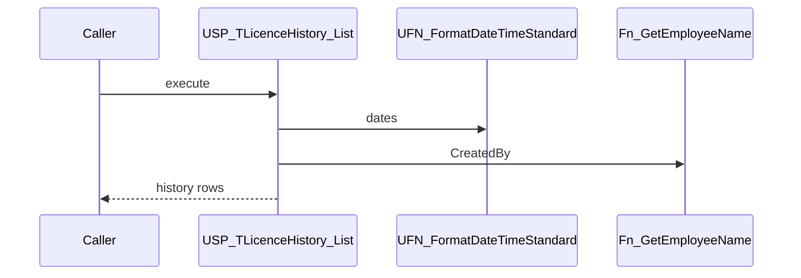
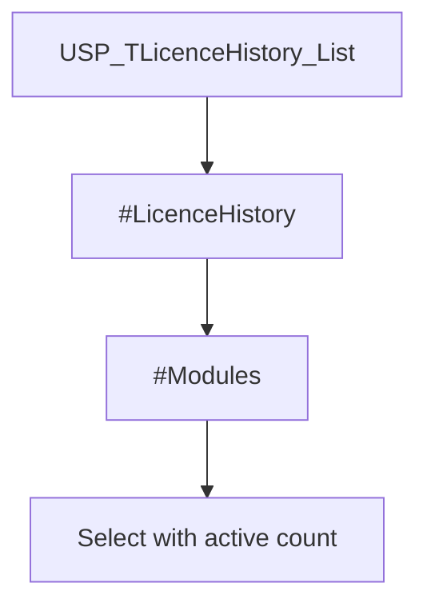

# USP_TLicenceHistory_List

## What it does

Returns history snapshots for one licence, including employer display name, contacts, AM fields, module name list from `TEmployerModuleHistory`, product location label, document display name, and a live active-employee count under that employer as root.

## Parameters

| Name | Direction | What it is for |
|---|---|---|
| `@LicenceID` | in | Licence whose history rows to return |

## Call sequence

## Callers

No other procedure calls this object. `dashBoardDAL.GetHRMSLicenseHistoryList` executes it from the Manage Licenses history UI.

## Nested

| Object | Kind | When | Page |
|---|---|---|---|
| `UFN_FormatDateTimeStandard` | function | date/datetime columns | [UFN_FormatDateTimeStandard](/docs/database/hrms/UFN_FormatDateTimeStandard) |
| `Fn_GetEmployeeName` | function | CreatedBy display | [Fn_GetEmployeeName](/docs/database/hrms/Fn_GetEmployeeName) |

## Steps

1. Load `TLicenceHistory` for `@LicenceID` into `#LicenceHistory` with employer name and formatted fields.
2. Aggregate module names from `TEmployerModuleHistory` / `THrmsModules` into `#Modules`.
3. Return history rows left-joined to modules, plus active-employee count and document display name.

## Tables

| Table | Read or write |
|---|---|
| `dbo.TLicenceHistory` | read |
| `dbo.TEmployerDetails` | read |
| `dbo.TEmployerModuleHistory` | read |
| `dbo.THrmsModules` | read |
| `dbo.TEmployee` | read |

## Unresolved calls

None.

## Flow

