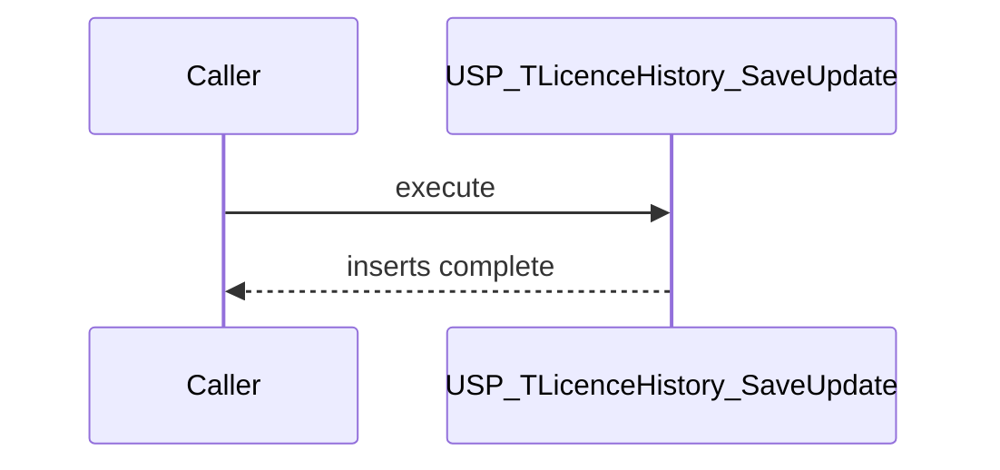
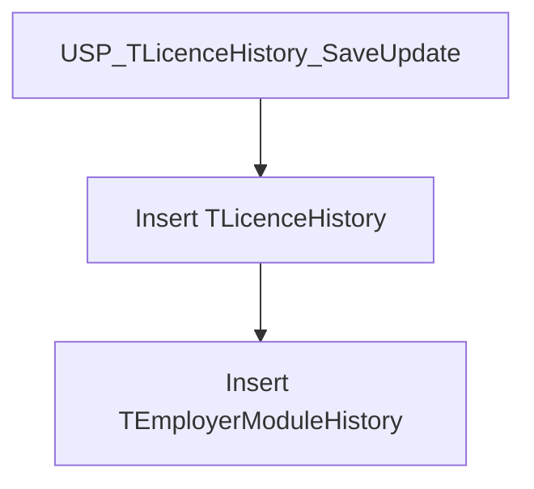

# USP_TLicenceHistory_SaveUpdate

## What it does

Copies the current `TLicence` row into `TLicenceHistory` and copies that licence's `TEmployerModule` rows into `TEmployerModuleHistory` for the new history id.

## Parameters

| Name | Direction | What it is for |
|---|---|---|
| `@LicenceID` | in | Licence to snapshot |
| `@CreatedBy` | in | Employee id stored as history creator |

## Call sequence

## Callers

Called only from `USP_TLicence_SaveUpdate` after insert or update.

## Nested

None.

## Steps

1. Insert one `TLicenceHistory` row from `TLicence` for `@LicenceID`, including soft-delete flags.
2. Capture `@LicenceHistoryID`.
3. Insert `TEmployerModuleHistory` rows from `TEmployerModule` for that licence.

## Tables

| Table | Read or write |
|---|---|
| `dbo.TLicence` | read |
| `dbo.TLicenceHistory` | write |
| `dbo.TEmployerModule` | read |
| `dbo.TEmployerModuleHistory` | write |

## Unresolved calls

None.

## Flow

