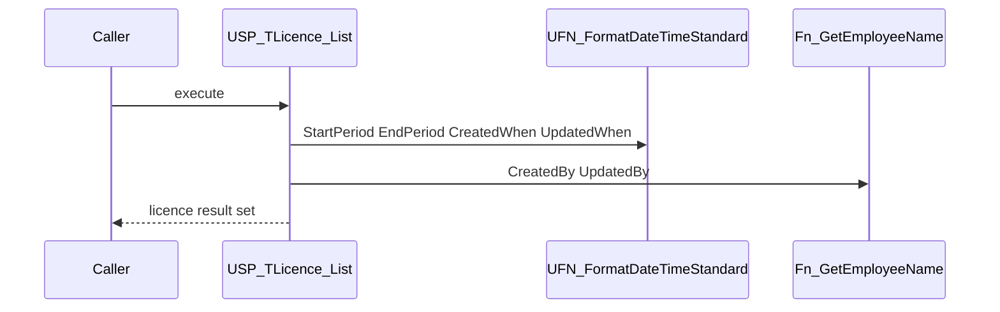
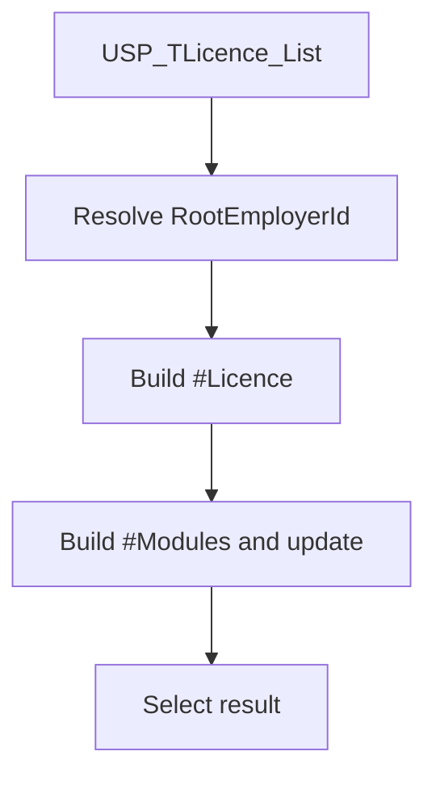

# USP_TLicence_List

## What it does

Returns licence rows with employer display name, AM/customer contacts, purchased/buffer counts, active employee count under the licence employer as root, aggregated module ids/names, formatted dates, product location label, document display name, and whether data retention has already deleted data.

## Parameters

| Name | Direction | What it is for |
|---|---|---|
| `@EmployerID` | in | Optional. When set, resolves `RootEmployerId` and filters `TLicence.EmployerID` to that root |
| `@LicenceID` | in | Optional filter to one licence |

## Call sequence

## Callers

No other procedure calls this object. `dashBoardDAL.GetHRMSLicenseList` executes it from HRMS Licenses and from module-access helpers that reuse the same route.

## Nested

| Object | Kind | When | Page |
|---|---|---|---|
| `UFN_FormatDateTimeStandard` | function | date/datetime display columns | [UFN_FormatDateTimeStandard](/docs/database/hrms/UFN_FormatDateTimeStandard) |
| `Fn_GetEmployeeName` | function | CreatedBy / UpdatedBy display | [Fn_GetEmployeeName](/docs/database/hrms/Fn_GetEmployeeName) |

## Steps

1. Resolve `@RootEmployerId` from `TEmployerDetails` when `@EmployerID` is supplied.
2. Load matching `TLicence` rows into `#Licence` with employer name, active-licence count under that root, retention `DataDeleted`, and null module placeholders.
3. Aggregate distinct modules from `TEmployerModule` / `THrmsModules` into `#Modules` and update the temp table.
4. Select the temp rows with a document display-name derived from the path.

## Tables

| Table | Read or write |
|---|---|
| `dbo.TLicence` | read |
| `dbo.TEmployerDetails` | read |
| `dbo.TEmployerDataRetention` | read |
| `dbo.TEmployerModule` | read |
| `dbo.THrmsModules` | read |
| `dbo.TEmployee` | read |
| `dbo.TEmployeeInfo` | read |

## Unresolved calls

None.

## Flow

