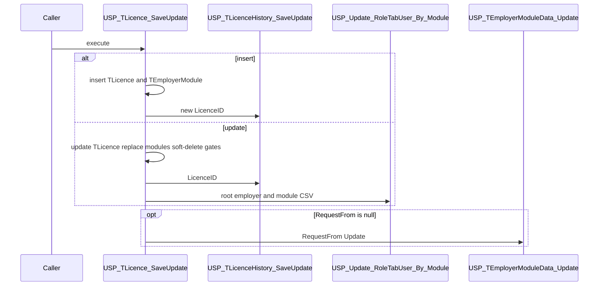
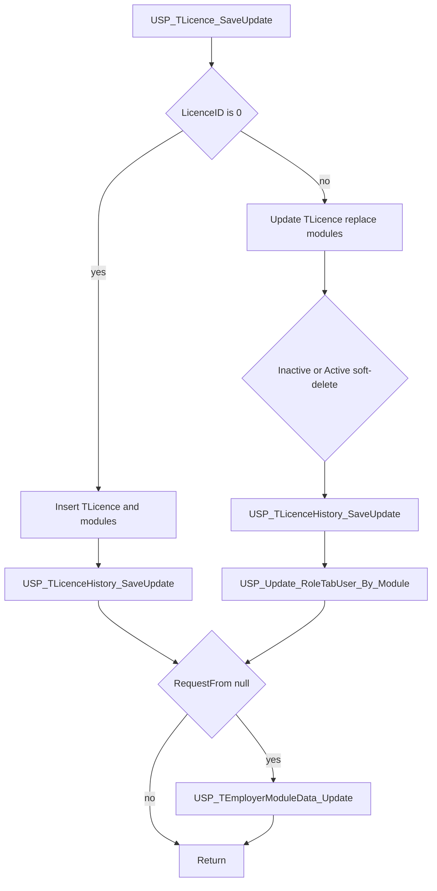

# USP_TLicence_SaveUpdate

## What it does

Inserts or updates one `TLicence` row for a parent employer, replaces that licence's `TEmployerModule` rows from a module-id CSV, and always writes a history snapshot. On update, Inactive soft-deletes users/employees/employers under the root tree; Active reverses a prior soft-delete. Update also syncs role/page/tab mappings for removed modules and rebuilds `TEmployerModuleData` unless `@RequestFrom` is set.

## Parameters

| Name | Direction | What it is for |
|---|---|---|
| `@LicenceID` | in | Null/0 inserts; otherwise updates that licence |
| `@EmployerID` | in | Parent organisation for the licence |
| `@ContactName` | in | Customer contact name |
| `@ContactNumber` | in | Customer contact number |
| `@EmailAddress` | in | Customer primary email(s) |
| `@ModuelIDs` | in | Comma-separated HRMS module ids |
| `@TotalLicence` | in | Purchased licence count |
| `@BufferLicence` | in | Buffer licence count |
| `@StartPeriod` | in | Go-live date |
| `@EndPeriod` | in | Expiry date |
| `@ProductLocation` | in | 1 Cloud, 2 On Premise |
| `@LicenceStatus` | in | Active / Inactive (and related soft-delete) |
| `@Comment` | in | Comments |
| `@DocumentName` | in | Optional attachment path |
| `@CreatedBy` | in | Creator employee id on insert |
| `@UpdatedBy` | in | Updater employee id on update |
| `@CustSecondaryEmail` | in | Customer secondary email(s) |
| `@AMName` | in | Account manager name |
| `@AMContactNumber` | in | AM contact |
| `@AMPrimaryEmail` | in | AM primary email(s) |
| `@AMSecondaryEmail` | in | AM secondary email(s) |
| `@RequestFrom` | in | When null, runs `USP_TEmployerModuleData_Update` |

## Call sequence

## Callers

No other procedure calls this object. `dashBoardDAL.UpdateHRMSLicense` executes it from HRMS Licenses (`UpdateHRMSLicense`).

## Nested

| Object | Kind | When | Page |
|---|---|---|---|
| `USP_TLicenceHistory_SaveUpdate` | procedure | after every insert or update | [USP_TLicenceHistory_SaveUpdate](/docs/database/hrms/USP_TLicenceHistory_SaveUpdate) |
| `USP_Update_RoleTabUser_By_Module` | procedure | update path only | [USP_Update_RoleTabUser_By_Module](/docs/database/hrms/USP_Update_RoleTabUser_By_Module) |
| `USP_TEmployerModuleData_Update` | procedure | when `@RequestFrom` is null | [USP_TEmployerModuleData_Update](/docs/database/hrms/USP_TEmployerModuleData_Update) |

## Steps

1. When `@LicenceID` is null/0, insert `TLicence`, capture identity, insert `TEmployerModule` from `STRING_SPLIT(@ModuelIDs)`, then call `USP_TLicenceHistory_SaveUpdate`.
2. Otherwise read prior soft-delete and status, update `TLicence`, delete and re-insert `TEmployerModule` for that licence.
3. If status becomes Inactive and not already soft-deleted, soft-delete active users, employees, and employer details under `RootEmployerid = @EmployerID`, then mark matching licences soft-deleted.
4. If status becomes Active and was soft-deleted, reverse those soft-deletes for the same tree.
5. Call history save with `@UpdatedBy`, then `USP_Update_RoleTabUser_By_Module`.
6. When `@RequestFrom` is null, execute `USP_TEmployerModuleData_Update` with `Update`.

## Tables

| Table | Read or write |
|---|---|
| `dbo.TLicence` | read, write |
| `dbo.TEmployerModule` | write |
| `dbo.TUsers` | write on Inactive/Active |
| `dbo.TEmployee` | write on Inactive/Active |
| `dbo.TEmployerDetails` | read, write on Inactive/Active |

## Unresolved calls

None.

## Flow

