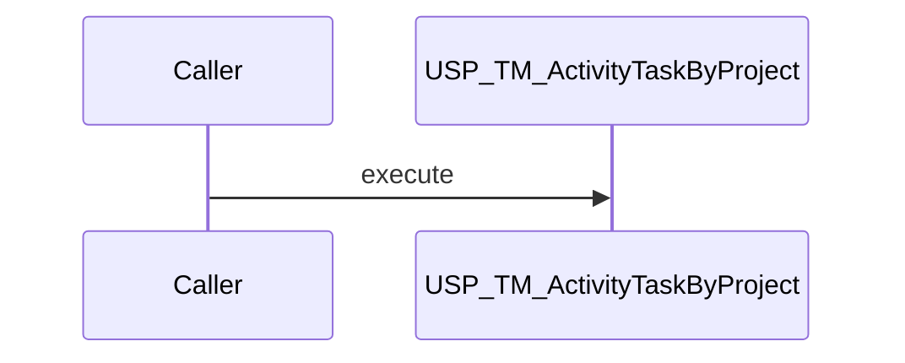
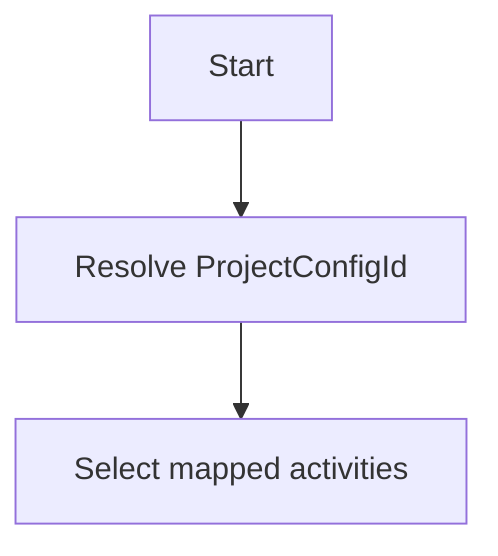

# USP_TM_ActivityTaskByProject

## What it does

Resolves the employee's project configuration for a project, then returns TimePort lookup activities mapped to that configuration. Used as the Task Report activity filter after a project is chosen.

## Parameters

| Name | Direction | What it is for |
|---|---|---|
| `@EmployeeID` | in | Employee with project mapping (`INT`) |
| `@EmployerID` | in | Employer scope (`INT`) |
| `@ProjectId` | in | Selected project (`INT`) |

## Call sequence

## Callers

No other procedure or function in `HRMS/STOREPROCEDURE` executes this object. Application caller: `employeeDAL.GetActivityByProject` → [Reports](/docs/guides/task-management/reports).

## Nested

None.

## Steps

1. Script is `HRMS-DATABASE/HRMS/STOREPROCEDURE/USP_TM_ActivityTaskByProject.sql`.
2. Resolve `@ProjectConfigId` from mapping + configuration for the employee/project.
3. Select distinct activity lookups from `TTSLookUpMappingTimePort` / `TTSLookUpTimePort` for that config.

## Tables

| Table | Access | What it is for |
|---|---|---|
| `TTSUserProjectMapping` / `TTSProjectConfiguration` / `TProject` | read | Resolve project config |
| `TTSLookUpMappingTimePort` / `TTSLookUpTimePort` | read | Activity lookup rows |

## Unresolved calls

None.

## Flow

