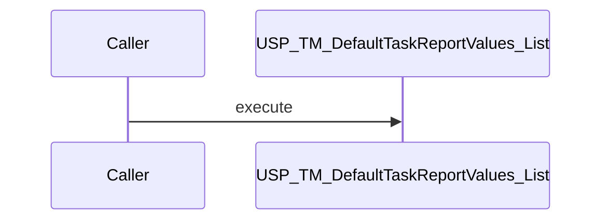
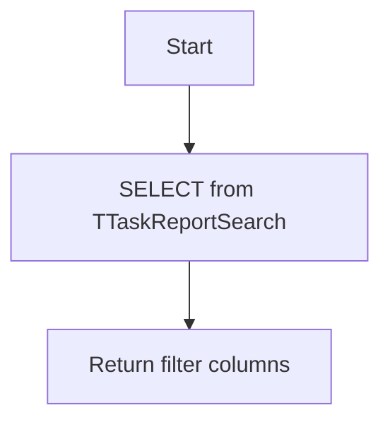

# USP_TM_DefaultTaskReportValues_List

## What it does

Loads the signed-in user's saved Task Report filter row for a search source (`TEAM` or `SELF`) from `TTaskReportSearch` (dates, employee/project/activity/status id lists).

## Parameters

| Name | Direction | What it is for |
|---|---|---|
| `@CreatedBy` | in | Employee who saved the defaults (`INT`) |
| `@searchSource` | in | Source key such as `TEAM` or `SELF` (`varchar(50)`) |

## Call sequence

## Callers

No other procedure or function in `HRMS/STOREPROCEDURE` executes this object. Application caller: `taskReportDAL.GetDefaultTaskList` → `taskReportController.GetDefaultTaskList` from [Reports](/docs/guides/task-management/reports).

## Nested

None.

## Steps

1. Script is `HRMS-DATABASE/HRMS/STOREPROCEDURE/USP_TM_DefaultTaskReportValues_List.sql`.
2. Select matching rows from `TTaskReportSearch` for `@CreatedBy` and `@searchSource`.

## Tables

| Table | Access | What it is for |
|---|---|---|
| `TTaskReportSearch` | read | Persisted default report filters |

## Unresolved calls

None.

## Flow

