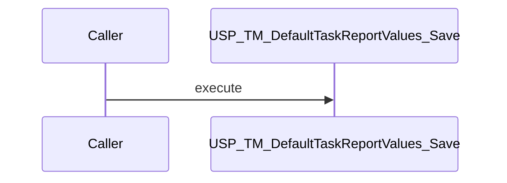
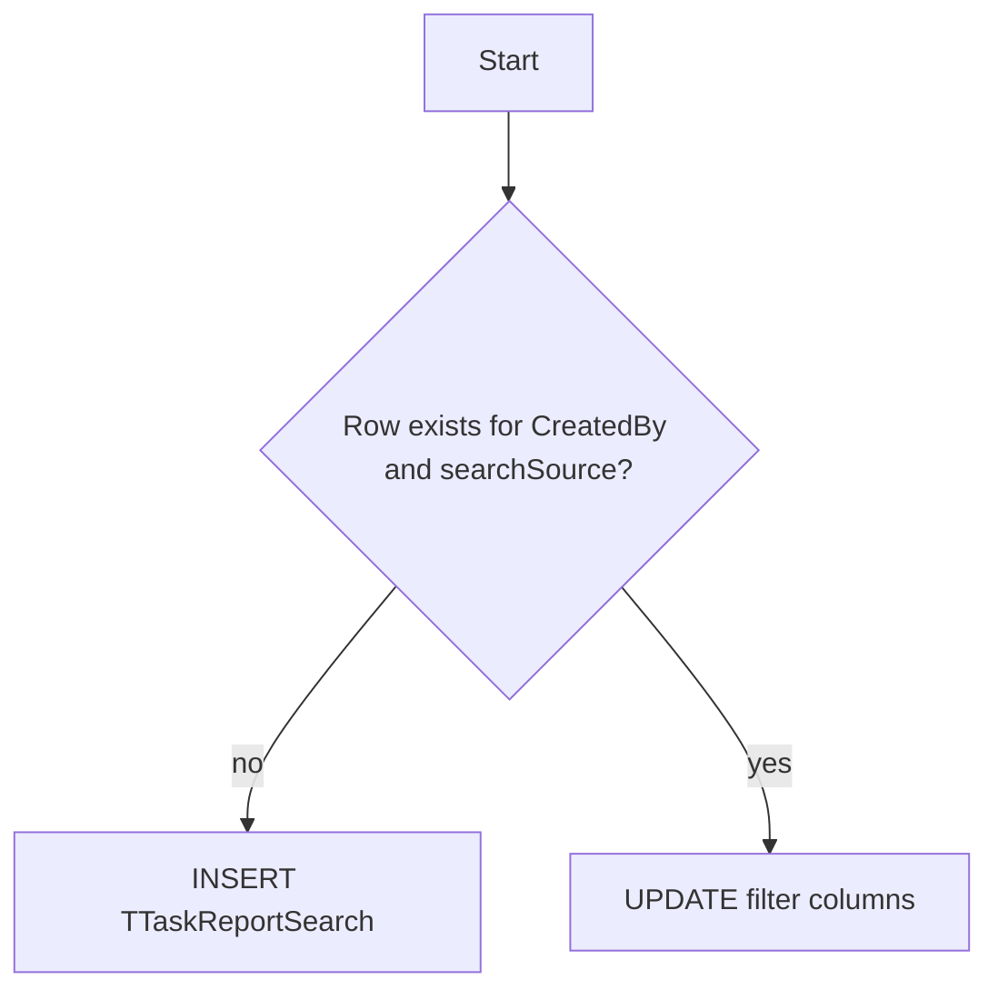

# USP_TM_DefaultTaskReportValues_Save

## What it does

Inserts or updates the caller's saved Task Report filter row in `TTaskReportSearch` for a given `searchSource`. Invoked from `GetTaskReportListBySearch` when the client sends `IsDefault = true`.

## Parameters

| Name | Direction | What it is for |
|---|---|---|
| `@EmployeeIDs` | in | Declared `INT` in script (DAL passes varchar CSV) — stored employee filter |
| `@StartDate` / `@EndDate` | in | Saved date window |
| `@ProjectIDs` / `@ActivityIDs` / `@StatusIDs` | in | CSV filter lists (`VARCHAR(MAX)`) |
| `@CreatedBy` | in | Owning employee (`INT`) |
| `@searchSource` | in | `TEAM` / `SELF` (and RequestType from search path) |

## Call sequence

## Callers

No other procedure or function in `HRMS/STOREPROCEDURE` executes this object. Application caller: `taskReportDAL.SaveTaskReportListBySearch` inside `taskReportBLL.GetTaskReportListBySearch` when `IsDefault` is set — [Reports](/docs/guides/task-management/reports).

## Nested

None.

## Steps

1. Script is `HRMS-DATABASE/HRMS/STOREPROCEDURE/USP_TM_DefaultTaskReportValues_Save.sql`.
2. If no row for `@CreatedBy` + `@searchSource`, INSERT into `TTaskReportSearch`.
3. Else UPDATE the same key with new filter values and `CreatedWhen = GETDATE()`.

## Tables

| Table | Access | What it is for |
|---|---|---|
| `TTaskReportSearch` | read/write | Upsert saved defaults |

## Unresolved calls

None. Parameter/`searchSource` typing vs DAL `RequestType` / CSV employee ids is a known contract smell.

## Flow

