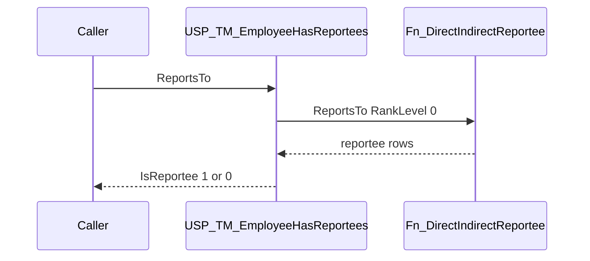
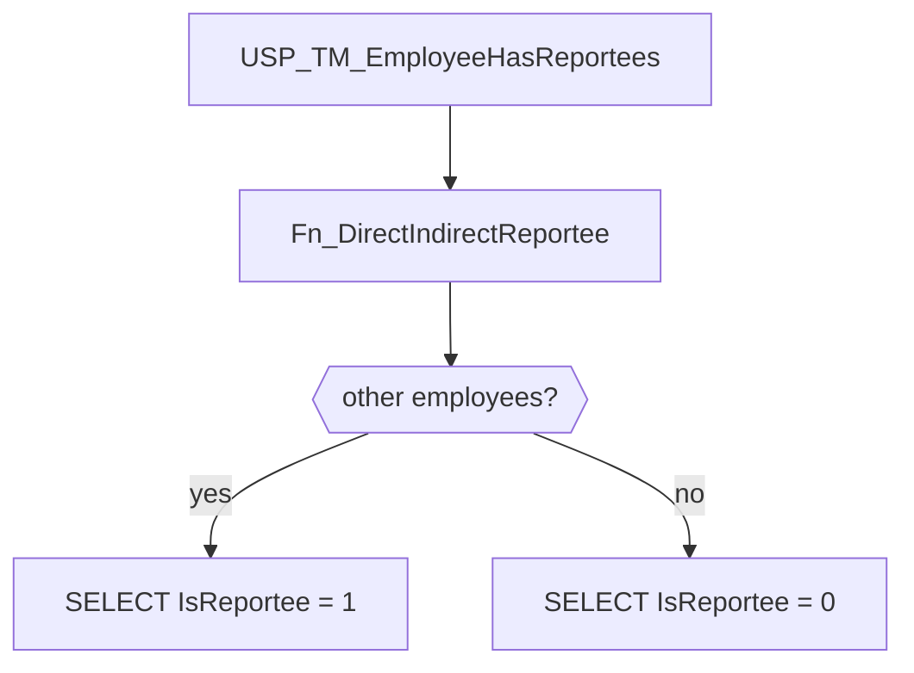

# USP_TM_EmployeeHasReportees

## What it does

Returns a single-row flag for Task Management UI. If `Fn_DirectIndirectReportee(@ReportsTo, 0)` contains any employee other than `@ReportsTo`, the procedure selects `IsReportee = 1`; otherwise `IsReportee = 0`. The MasterPages shell uses this to show the Team Review accordion and Create Task tab.

## Parameters

| Name | Direction | What it is for |
|---|---|---|
| `@ReportsTo` | in | Logged-in employee id to test for reportees |

## Call sequence

## Callers

| Object | Kind | Page |
|---|---|---|
| Task Management API `employeeDAL.CheckEmployeeHasReportees` | application | [Task Management Notifications](/docs/guides/task-management/notifications) |

## Nested

| Object | Kind | When | Page |
|---|---|---|---|
| `Fn_DirectIndirectReportee` | function | always | [Fn_DirectIndirectReportee](/docs/database/hrms/Fn_DirectIndirectReportee) |

## Steps

1. Script is `HRMS-DATABASE/HRMS/STOREPROCEDURE/USP_TM_EmployeeHasReportees.sql`.
2. `IF EXISTS` over `Fn_DirectIndirectReportee(@ReportsTo, 0)` excluding self.
3. Select `1 AS IsReportee` or `0 AS IsReportee`. No writes.

## Tables

| Table | Read or write |
|---|---|
| (via `Fn_DirectIndirectReportee`) `TORGChart` / employee tables | read |

## Unresolved calls

None at one nested level beyond `Fn_DirectIndirectReportee`.

## Flow

