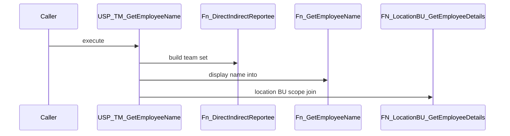
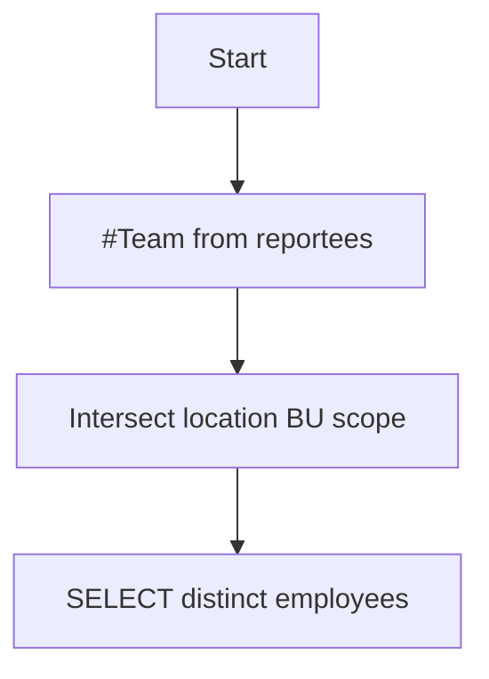

# USP_TM_GetEmployeeName

## What it does

Returns the manager's direct/indirect reportees (excluding self) who fall in the manager's location/BU access scope, with display name and employment number. Powers the Team Task Report employee filter.

## Parameters

| Name | Direction | What it is for |
|---|---|---|
| `@ManagerId` | in | Manager employee id (`INT`) |
| `@EmployerId` | in | Declared; current body does not filter the final select by this alone (`INT`) |

## Call sequence

## Callers

No other procedure or function in `HRMS/STOREPROCEDURE` executes this object. Application caller: `employeeDAL.GetEmployeeNameByReportingManager` → [Reports](/docs/guides/task-management/reports).

## Nested

| Object | Kind | When | Page |
|---|---|---|---|
| `Fn_DirectIndirectReportee` | function | reportee expansion | [Fn_DirectIndirectReportee](/docs/database/hrms/Fn_DirectIndirectReportee) |
| `Fn_GetEmployeeName` | function | `#Team.EmployeeName` | [Fn_GetEmployeeName](/docs/database/hrms/Fn_GetEmployeeName) |
| `FN_LocationBU_GetEmployeeDetails` | function | scope filter (PBI 70985) | [FN_LocationBU_GetEmployeeDetails](/docs/database/hrms/FN_LocationBU_GetEmployeeDetails) |

## Steps

1. Script is `HRMS-DATABASE/HRMS/STOREPROCEDURE/USP_TM_GetEmployeeName.sql`.
2. Insert `#Team` from `Fn_DirectIndirectReportee`, active employees, names, employment numbers, intersected with `FN_LocationBU_GetEmployeeDetails`.
3. Select distinct team members with org hierarchy join, ordered by name.

## Tables

| Table | Access | What it is for |
|---|---|---|
| `TEmployee` / `TEmployeeInfo` | read | Active employees and employment numbers |
| `TEmployerDetails` / `TOrgHierarchyDetails` | read | Employer and BU join |
| `TEmployeeContactDetails` / `TTitle` / `TLocation` | read | Optional joins (not all projected) |

## Unresolved calls

None.

## Flow

