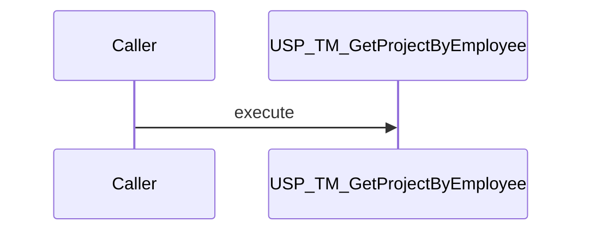
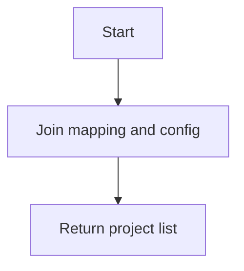

# USP_TM_GetProjectByEmployee

## What it does

Lists active projects mapped to an employee via `TTSUserProjectMapping` / `TTSProjectConfiguration` for the given employer. Used as the Task Report project filter.

## Parameters

| Name | Direction | What it is for |
|---|---|---|
| `@EmployeeId` | in | Employee whose project mappings are listed (`INT`) |
| `@Employerid` | in | Employer scope (`INT`) |

## Call sequence

## Callers

No other procedure or function in `HRMS/STOREPROCEDURE` executes this object. Application caller: `employeeDAL.GetProjectByEmployee` → [Reports](/docs/guides/task-management/reports).

## Nested

None.

## Steps

1. Script is `HRMS-DATABASE/HRMS/STOREPROCEDURE/USP_TM_GetProjectByEmployee.sql`.
2. Join active user-project mapping to project configuration and `TProject`.
3. Return distinct project id/name/config flags ordered by project id.

## Tables

| Table | Access | What it is for |
|---|---|---|
| `TTSUserProjectMapping` | read | Employee–project mapping |
| `TTSProjectConfiguration` | read | Active project config |
| `TProject` | read | Project name |

## Unresolved calls

None.

## Flow

