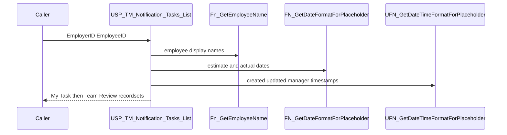
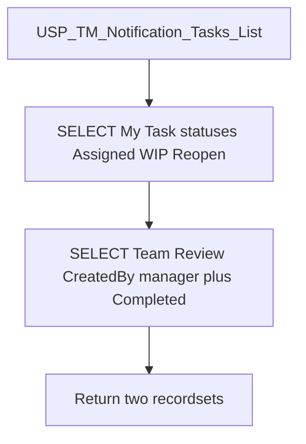

# USP_TM_Notification_Tasks_List

## What it does

Returns two read-only result sets for the Task Management Notifications inbox. Result set 1 lists the logged-in employee's own pending tasks (`Assigned` / `WIP` / `Reopen`). Result set 2 lists team tasks for review created by that employee (those statuses plus `Completed`), joined through `TORGChart` reportees. Each row includes project/stage/activity labels, formatted dates, and a `ChatNotification` flag when another user left unread chat on the task.

## Parameters

| Name | Direction | What it is for |
|---|---|---|
| `@EmployerID` | in | Employer scope for tasks and lookups |
| `@EmployeeID` | in | Assignee for My Task; creator / manager for Team Review |

## Call sequence

## Callers

| Object | Kind | Page |
|---|---|---|
| Task Management API `taskNotificationDAL.GetPendingMyTask` | application | [Task Management Notifications](/docs/guides/task-management/notifications) |
| Task Management API `taskNotificationDAL.GetPendingTeamTaskSForReview` | application | same SP; UI path currently unused on Notifications mount |

## Nested

| Object | Kind | When | Page |
|---|---|---|---|
| `Fn_GetEmployeeName` | function | EmployeeName / CreatedBy / UpdatedBy | [Fn_GetEmployeeName](/docs/database/hrms/Fn_GetEmployeeName) |
| `FN_GetDateFormatForPlaceholder` | function | Estimated and actual date columns | [FN_GetDateFormatForPlaceholder](/docs/database/hrms/FN_GetDateFormatForPlaceholder) |
| `UFN_GetDateTimeFormatForPlaceholder` | function | CreatedWhen / UpdatedWhen / ManagerUpdatedWhen | [UFN_GetDateTimeFormatForPlaceholder](/docs/database/hrms/UFN_GetDateTimeFormatForPlaceholder) |

## Steps

1. Script is `HRMS-DATABASE/HRMS/STOREPROCEDURE/USP_TM_Notification_Tasks_List.sql`.
2. First `SELECT`: active `TTaskMaster` for `@EmployeeID` / `@EmployerID` with status Reopen, WIP, Assigned; left join project, TimePort lookups, unread `TTaskChat`.
3. Second `SELECT`: active tasks where `CreatedBy = @EmployeeID`, org-chart join to reportees, status also includes Completed; same display columns and chat flag.
4. Both sets order by `TaskID` descending. No writes.

## Tables

| Table | Read or write |
|---|---|
| `TTaskMaster` | read |
| `TTaskStatus` | read |
| `TEmployeeInfo` | read |
| `TProject` | read |
| `TTSLookUpTimePort` | read |
| `TTaskChat` | read |
| `TORGChart` | read (Team Review only) |

## Unresolved calls

None for nested scalar functions listed above. Inline `SELECT TOP 1 Lookup_Name FROM TTSLookUpTimePort` for `TaskTitleName` is not a separate object.

## Flow

