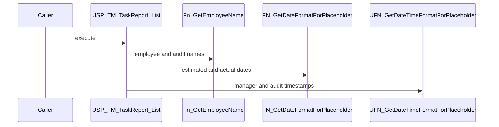
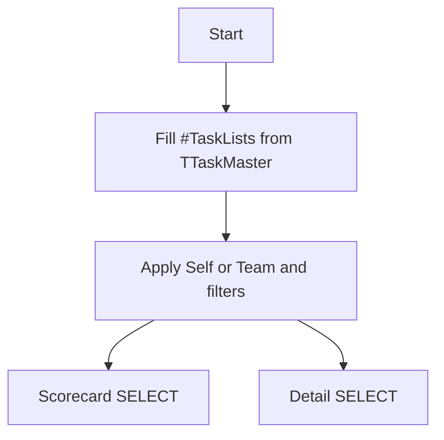

# USP_TM_TaskReport_List

## What it does

Builds the Task Report result for Self or Team: a scorecard recordset (distinct project/activity/task/employee counts) and a detailed task grid from `TTaskMaster`, with project/client/LOB/cost-center/lifecycle/activity labels and chat counts. Filters by employee, date window on estimated dates, project, activity, and status CSVs.

## Parameters

| Name | Direction | What it is for |
|---|---|---|
| `@EmployeeID` | in | Login employee (`INT`) — Self scopes assignee; Team scopes `CreatedBy` |
| `@RequestType` | in | `SELF` or `TEAM` (`VARCHAR(MAX)`, default `SELF`) |
| `@FromDate` / `@ToDate` | in | Optional estimated-date window |
| `@EmployeeIDs` / `@ProjectIDs` / `@ActivityIDs` / `@StatusIDs` | in | Optional CSV filters |
| `@IsDefault` | in | Declared; body no longer branches on it (commented year override) |

## Call sequence

## Callers

No other procedure or function in `HRMS/STOREPROCEDURE` executes this object. Application callers: `taskReportDAL.GetTaskReportListBySearch` and `GetTaskReportForManager` — [Reports](/docs/guides/task-management/reports).

## Nested

| Object | Kind | When | Page |
|---|---|---|---|
| `Fn_GetEmployeeName` | function | employee / created / updated names | [Fn_GetEmployeeName](/docs/database/hrms/Fn_GetEmployeeName) |
| `FN_GetDateFormatForPlaceholder` | function | date display columns | [FN_GetDateFormatForPlaceholder](/docs/database/hrms/FN_GetDateFormatForPlaceholder) |
| `UFN_GetDateTimeFormatForPlaceholder` | function | datetime display columns | [UFN_GetDateTimeFormatForPlaceholder](/docs/database/hrms/UFN_GetDateTimeFormatForPlaceholder) |

## Steps

1. Script is `HRMS-DATABASE/HRMS/STOREPROCEDURE/USP_TM_TaskReport_List.sql`.
2. Build `#TaskLists` from active `TTaskMaster` joined to employee info, project config, client, lookups.
3. Apply Self (`EmployeeID`) vs Team (`CreatedBy`) and CSV / date filters.
4. Return scorecard aggregates, then distinct task detail rows ordered by `TaskID` desc.

## Tables

| Table | Access | What it is for |
|---|---|---|
| `TTaskMaster` | read | Task rows |
| `TEmployeeInfo` | read | Employment number / join |
| `TProject` / `TTSProjectConfiguration` / `TClient` | read | Project and client labels |
| `TTSLookUpTimePort` | read | Stage, activity, LOB, cost center, task title |
| `TEmployerDetails` | read | Employer name |
| `TTaskChat` | read | Chat line count subquery |

## Unresolved calls

None.

## Flow

