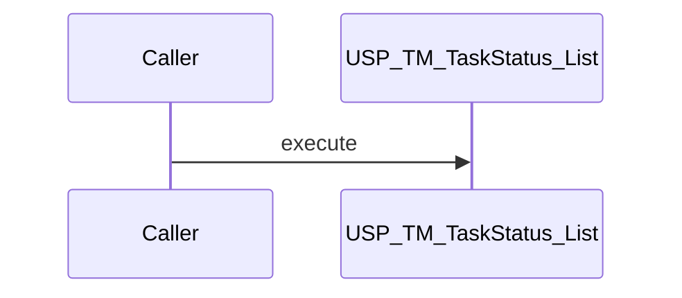
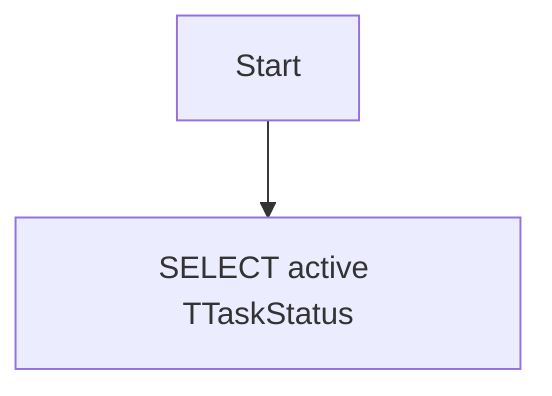

# USP_TM_TaskStatus_List

## What it does

Returns all active task status codes from `TTaskStatus` for Task Report status filters. Takes no parameters (UI may still post unused body fields).

## Parameters

None.

## Call sequence

## Callers

No other procedure or function in `HRMS/STOREPROCEDURE` executes this object. Application caller: `taskReportDAL.GetTaskReportStatus` → [Reports](/docs/guides/task-management/reports).

## Nested

None.

## Steps

1. Script is `HRMS-DATABASE/HRMS/STOREPROCEDURE/USP_TM_TaskStatus_List.sql`.
2. Select `TaskStatusID` and `TaskStatus` where `IsActive = 1`.

## Tables

| Table | Access | What it is for |
|---|---|---|
| `TTaskStatus` | read | Active status list |

## Unresolved calls

None.

## Flow

