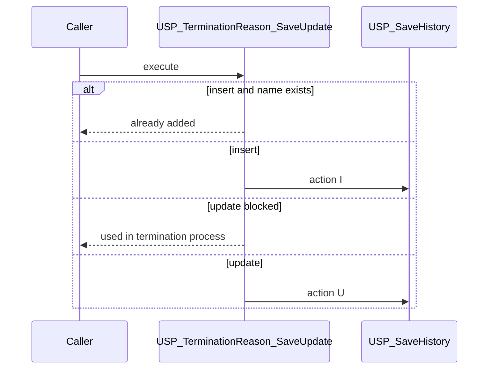
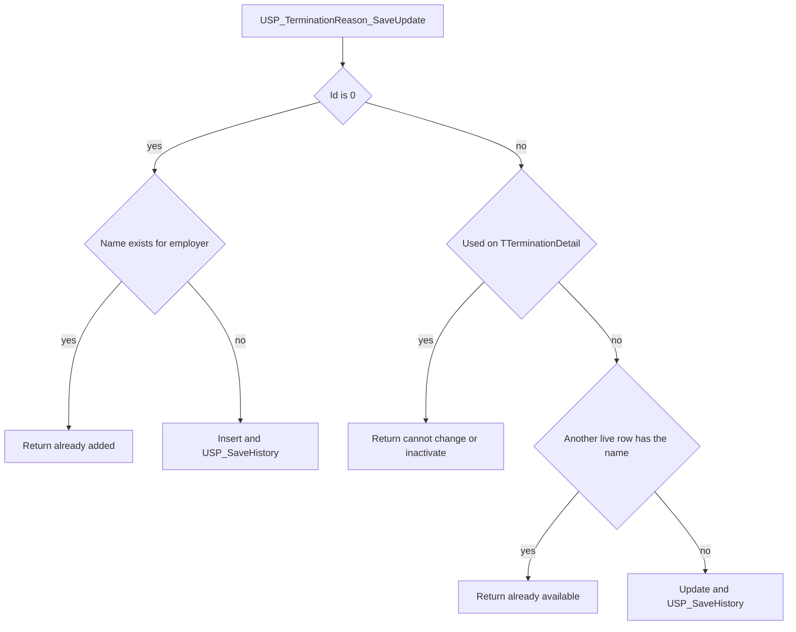

# USP_TerminationReason_SaveUpdate

## What it does

Adds or updates one termination reason. A new reason is rejected when the same text already exists for the employer and is not deleted. An update is blocked when `TTerminationDetail` already uses the reason and the text would change or the reason would be inactivated. A reason that is not used is also rejected when another live row has the same text. A successful save calls `USP_SaveHistory`.

## Parameters

| Name | Direction | What it is for |
|---|---|---|
| `@TerminationReasonID` | in | 0 or null inserts. A positive id updates |
| `@TerminationReason` | in | Reason text, `varchar(100)` |
| `@IsActive` | in | Active flag |
| `@EmployerID` | in | Organisation. The duplicate check on update does not filter by employer |
| `@CreatedBy` | in | Employee stored on insert and passed to history for an insert |
| `@UpdatedBy` | in | Employee stored on update and passed to history for an update |

## Call sequence

## Callers

No other procedure or function calls this object.

## Nested

| Object | Kind | When | Page |
|---|---|---|---|
| `USP_SaveHistory` | procedure | after a successful insert or update | No page yet |

`USP_SaveHistory` is executed by name. Its script is not in `HRMS-DATABASE`.

## Steps

1. When the id is null or 0, and a non-deleted `TTerminationReason` row for this employer already has the same text, select `Termination Reason already added.` and return. Otherwise insert the reason and execute `USP_SaveHistory` with action `I`.

2. On update, read the current text and active flag. When `TTerminationDetail` has this `TerminationReasonID`, return without updating if the text would change while the reason stays active, if an active reason would become inactive, or if both would happen.

3. When no termination detail uses the reason, and another non-deleted row has the same text, select `Termination Reason already available.` and return. That check does not filter by employer.

4. Update `TerminationReason`, `IsActive`, `UpdatedBy`, and `UpdatedWhen` for the id and employer, then execute `USP_SaveHistory` with action `U`.

## Tables

| Table | Read or write |
|---|---|
| `TTerminationReason` | read and write |
| `TTerminationDetail` | read, on update, to see whether the reason is in use |

## Flow

