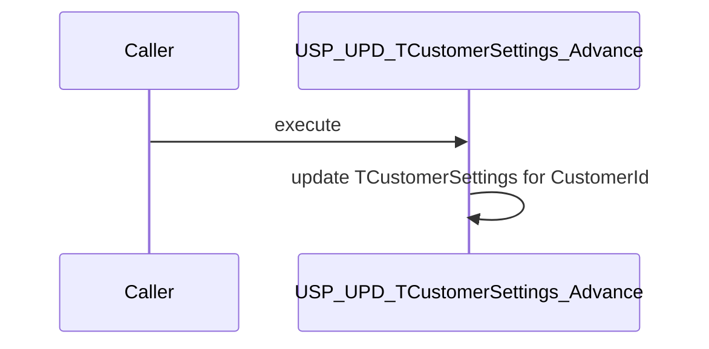
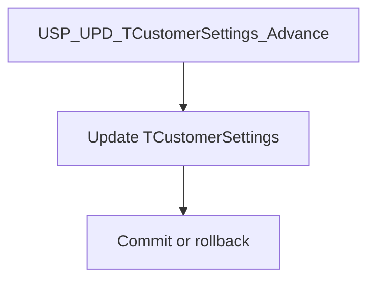

# USP_UPD_TCustomerSettings_Advance

## What it does

Updates advance-request comment and reapply columns on `TCustomerSettings` for one customer.

## Parameters

| Name | Direction | What it is for |
|---|---|---|
| `@CustomerId` | in | Customer number |
| `@IsAdvanceUserCommentMandatory` | in | User comment mandatory |
| `@IsAdvanceApproverCommentMandatory` | in | Approver comment mandatory |
| `@IsAdvanceRejectCommentMandatory` | in | Reject comment mandatory |
| `@IsReapplyAdvanceEnabled` | in | Reapply advance enabled |
| `@MaxReapplyAdvanceCount` | in | Max reapply count |

## Call sequence

## Callers

No other procedure or function calls this object. `UpdateSetupCustomerSetting` executes it when the Customer Config Setup Customer Setting tab maps to this procedure.

## Nested

Calls no other procedures or functions.

## Steps

1. In `HRMS-DATABASE/HRMS/STOREPROCEDURE/USP_UPD_TCustomerSettings_Advance.sql`, begin a transaction.
2. Update `TCustomerSettings` for `@CustomerId`, keeping existing values when a parameter is null (`COALESCE` / `ISNULL`).
3. Commit on success; roll back on error.

## Tables

| Table | Read or write |
|---|---|
| `dbo.TCustomerSettings` | write |

## Flow

