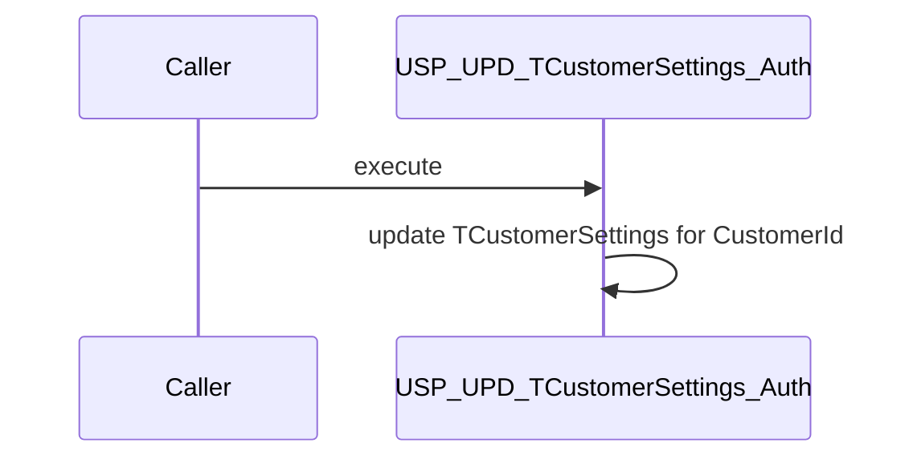
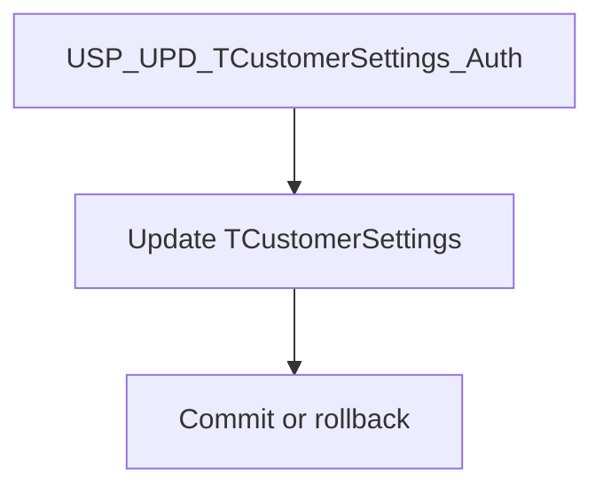

# USP_UPD_TCustomerSettings_Auth

## What it does

Updates authentication and login-related columns on `TCustomerSettings` for one customer (Office 365 / email login, cloud vs on-premises, external login, policy consent, forgot password, Azure keys). Null parameters keep the stored value.

## Parameters

| Name | Direction | What it is for |
|---|---|---|
| `@CustomerId` | in | Customer number |
| `@IsOffice365LoginEnabled` | in | Office 365 login flag |
| `@IsEmailLoginEnabled` | in | Email login flag |
| `@IsCloudOrOnPremises` | in | Cloud or on-premises bit, stored as Y/N |
| `@IsExternalLogin` | in | External login flag |
| `@ExternalLogin_AppId` | in | External login app id |
| `@ExternalLogin_Authority` | in | External login authority |
| `@ExternalLoginDomains` | in | External login domains |
| `@IsShowPolicyConsent` | in | Show policy consent at login |
| `@IsForgotPasswordEnabled` | in | Forgot-password flag |
| `@AzureSubscriptionKey` | in | Azure subscription key |
| `@AzureApplicationClientId` | in | Azure application client id |
| `@AzureApplicationTenantId` | in | Azure application tenant id |
| `@AzureApplicationClientSecret` | in | Azure application client secret |

## Call sequence

## Callers

No other procedure or function calls this object. `UpdateSetupCustomerSetting` executes it when the Customer Config Setup Customer Setting tab maps to this procedure.

## Nested

Calls no other procedures or functions.

## Steps

1. In `HRMS-DATABASE/HRMS/STOREPROCEDURE/USP_UPD_TCustomerSettings_Auth.sql`, begin a transaction.
2. Update `TCustomerSettings` for `@CustomerId`, keeping existing values when a parameter is null (`COALESCE` / `ISNULL`).
3. Commit on success; roll back on error.

## Tables

| Table | Read or write |
|---|---|
| `dbo.TCustomerSettings` | write |

## Flow

