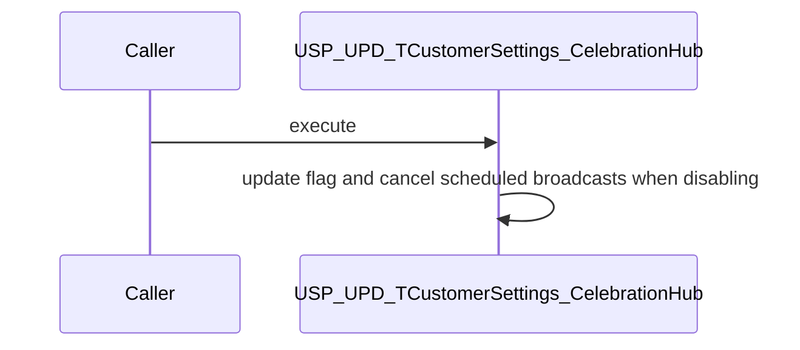
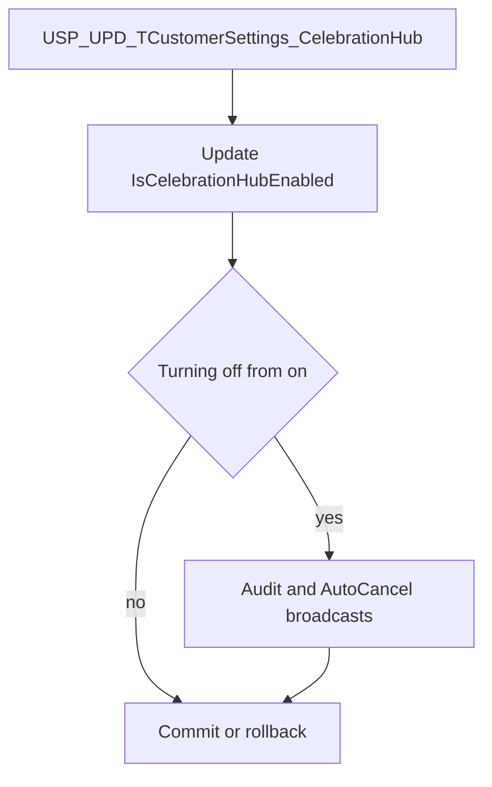

# USP_UPD_TCustomerSettings_CelebrationHub

## What it does

Sets `IsCelebrationHubEnabled` on `TCustomerSettings` for one customer. When the hub is being turned off from on, it auto-cancels scheduled celebration broadcasts for that employer, writes `TCelebrationAuditLog` rows, and clears lease fields on those broadcasts.

## Parameters

| Name | Direction | What it is for |
|---|---|---|
| `@CustomerId` | in | Customer number |
| `@IsCelebrationHubEnabled` | in | Celebration Hub enabled flag |

## Call sequence

Calls no other procedures or functions.

## Callers

No other procedure or function calls this object. `UpdateSetupCustomerSetting` executes it when `tab` is `celebrationHub`.

## Nested

Calls no other procedures or functions.

## Steps

1. In `HRMS-DATABASE/HRMS/STOREPROCEDURE/USP_UPD_TCustomerSettings_CelebrationHub.sql`, begin a transaction.
2. When disabling a previously enabled hub, capture the employer id into a table variable.
3. Update `IsCelebrationHubEnabled` on `TCustomerSettings`.
4. For employers being disabled, insert audit rows and set matching `TCelebrationBroadcast` rows in `Scheduled` / `AutoScheduled` to `AutoCancelled` with processing state `Done`.
5. Commit or roll back.

## Tables

| Table | Read or write |
|---|---|
| `dbo.TCustomerSettings` | read, write |
| `dbo.TCelebrationBroadcast` | read, write |
| `dbo.TCelebrationAuditLog` | write |

## Flow

