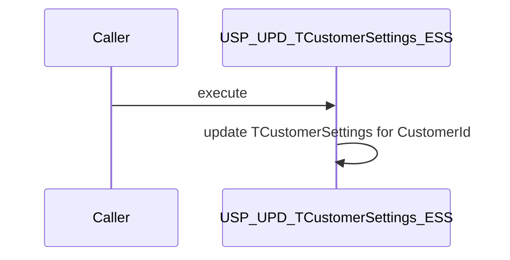
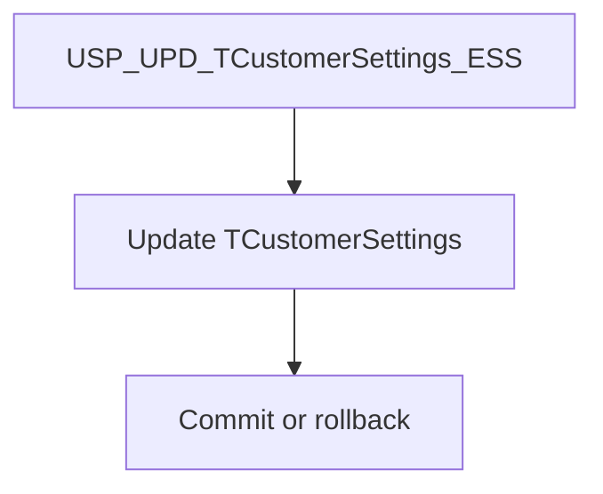

# USP_UPD_TCustomerSettings_ESS

## What it does

Updates ESS help-desk assign columns on `TCustomerSettings` for one customer (`HelpDeskRequestAssign`, `MapHelpdeskActivityOwner`).

## Parameters

| Name | Direction | What it is for |
|---|---|---|
| `@CustomerId` | in | Customer number |
| `@HelpDeskRequestAssign` | in | Help-desk request assign mode |
| `@MapHelpdeskActivityOwner` | in | Map activity owner mode |

## Call sequence

## Callers

No other procedure or function calls this object. `UpdateSetupCustomerSetting` executes it when the Customer Config Setup Customer Setting tab maps to this procedure.

## Nested

Calls no other procedures or functions.

## Steps

1. In `HRMS-DATABASE/HRMS/STOREPROCEDURE/USP_UPD_TCustomerSettings_ESS.sql`, begin a transaction.
2. Update `TCustomerSettings` for `@CustomerId`, keeping existing values when a parameter is null (`COALESCE` / `ISNULL`).
3. Commit on success; roll back on error.

## Tables

| Table | Read or write |
|---|---|
| `dbo.TCustomerSettings` | write |

## Flow

