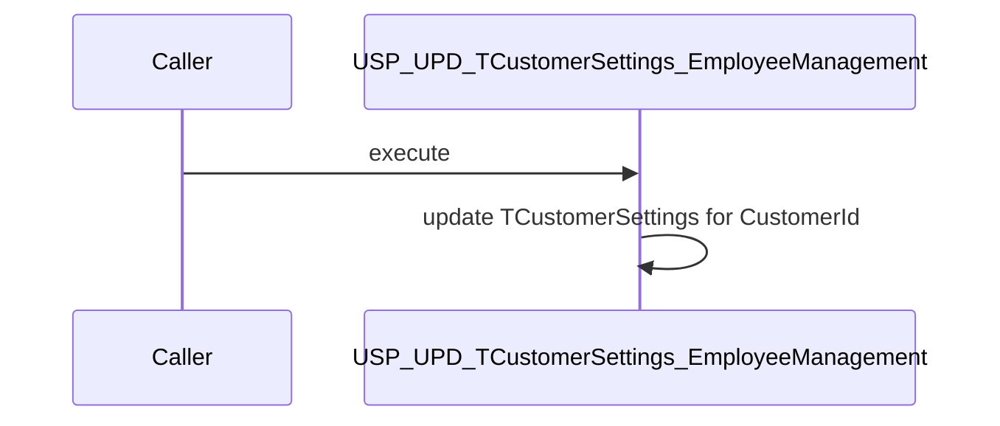
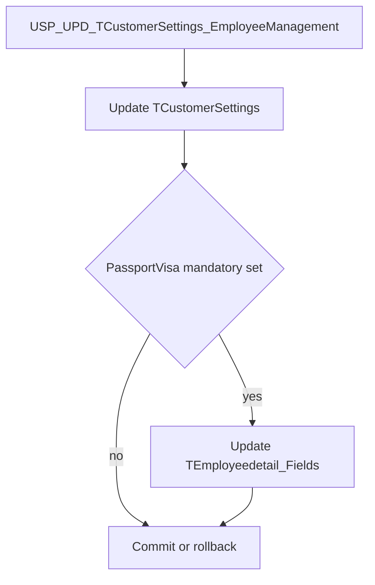

# USP_UPD_TCustomerSettings_EmployeeManagement

## What it does

Updates employee-management flags on `TCustomerSettings` for one customer. When passport/visa mandatory is toggled, it also sets `IsMandatory` on system Passport and Visa fields in `TEmployeedetail_Fields` (except a fixed name/number set).

## Parameters

| Name | Direction | What it is for |
|---|---|---|
| `@CustomerId` | in | Customer number |
| `@IsStateMandatoryMyDetails` | in | State mandatory on My Details |
| `@IsEmployeeProfileChange` | in | Allow employee profile change |
| `@AllowChangingEmploymentNumber` | in | Allow employment number change |
| `@IsGradeEnable` | in | Enable grade |
| `@IsIncludeMiddleName` | in | Show middle name |
| `@IsCostCenterEnabled` | in | Cost center enabled |
| `@IsEnableAutoWelcomeEmail` | in | Auto welcome email |
| `@IsPassportVisaMandatory` | in | Passport and visa mandatory |
| `@SendRetirementAgeNotfication` | in | Retirement age notification mode |
| `@IsMultiplePayrollAllowed` | in | Multiple payroll allowed |
| `@IsAllowDeactivationFromSearchEmployee` | in | Allow deactivation from search |

## Call sequence

## Callers

No other procedure or function calls this object. `UpdateSetupCustomerSetting` executes it when the Customer Config Setup Customer Setting tab maps to this procedure.

## Nested

Calls no other procedures or functions.

## Steps

1. In `HRMS-DATABASE/HRMS/STOREPROCEDURE/USP_UPD_TCustomerSettings_EmployeeManagement.sql`, begin a transaction.
2. Update `TCustomerSettings` for `@CustomerId`, keeping existing values when a parameter is null (`COALESCE` / `ISNULL`).
3. When `@IsPassportVisaMandatory` is 1 or 0, update matching Passport/Visa system fields in `TEmployeedetail_Fields` for the employer resolved from `TEmployerDetails.CustId`.
4. Commit on success; roll back on error.

## Tables

| Table | Read or write |
|---|---|
| `dbo.TCustomerSettings` | write |
| `dbo.TEmployerDetails` | read |
| `dbo.TEmployeedetail_Fields` | write |
| `dbo.TEmployeeDetail_Section` | read |

## Flow

