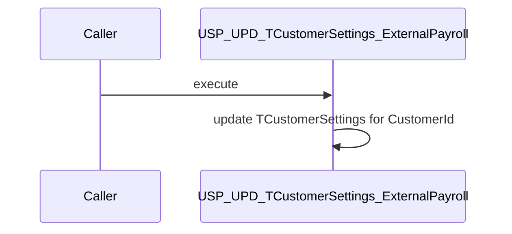
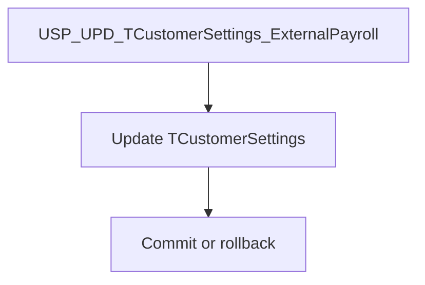

# USP_UPD_TCustomerSettings_ExternalPayroll

## What it does

Updates Saral / external-payroll columns on `TCustomerSettings` and matching `BaseUrl`, `IsEnabled`, and `ProviderName` on `TExternal_Payroll_Configuration` for the same customer.

## Parameters

| Name | Direction | What it is for |
|---|---|---|
| `@CustomerId` | in | Customer number |
| `@SaralIntegration` | in | Saral integration flag |
| `@SaralIntegrationLogoutURL` | in | Saral logout URL |
| `@SaralIntegrationURL` | in | Saral URL |
| `@baseUrl` | in | External payroll base URL |
| `@isEnabled` | in | External payroll enabled |
| `@ProviderName` | in | External payroll provider name |

## Call sequence

## Callers

No other procedure or function calls this object. `UpdateSetupCustomerSetting` executes it when the Customer Config Setup Customer Setting tab maps to this procedure.

## Nested

Calls no other procedures or functions.

## Steps

1. In `HRMS-DATABASE/HRMS/STOREPROCEDURE/USP_UPD_TCustomerSettings_ExternalPayroll.sql`, begin a transaction.
2. Update `TCustomerSettings` for `@CustomerId`, keeping existing values when a parameter is null (`COALESCE` / `ISNULL`).
3. Update `TExternal_Payroll_Configuration` for the same `@CustomerId`.
4. Commit on success; roll back on error.

## Tables

| Table | Read or write |
|---|---|
| `dbo.TCustomerSettings` | write |
| `dbo.TExternal_Payroll_Configuration` | write |

## Flow

