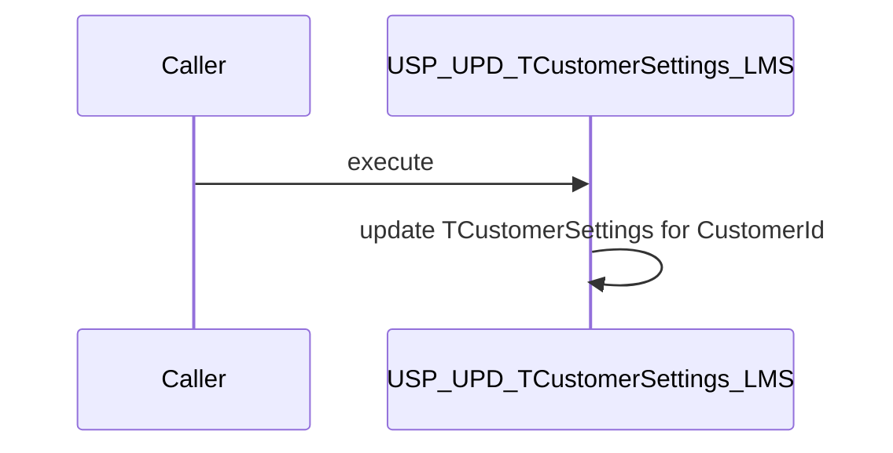
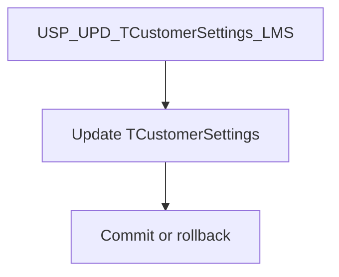

# USP_UPD_TCustomerSettings_LMS

## What it does

Updates LMS columns on `TCustomerSettings` for one customer. Fixed rating type and value are written only when the employer is a parent (`ParentEmployerId = 0`); children inherit the parent rating. After a parent update, matching child rating columns are synced when they differ.

## Parameters

| Name | Direction | What it is for |
|---|---|---|
| `@CustomerId` | in | Customer number |
| `@IsShowPostAssessment` | in | Post assessment allowed |
| `@IsShowTrainingSubCategory` | in | Training sub-category mandatory |
| `@TrainingCertificateDocument` | in | Training certificate document |
| `@IsGenerateQRCode` | in | Generate QR code |
| `@IsMSTeamEnabled` | in | MS Teams for LMS |
| `@TrainerCertificateDocument` | in | Trainer certificate document |
| `@IsWhatsAppEnabled` | in | WhatsApp notification |
| `@IsScreenshotEnable` | in | Screenshot facility for LMS content |
| `@RatingTypeId` | in | Global rating type |
| `@RatingValue` | in | Global rating value |
| `@FeedbackRatingTypeId` | in | Feedback rating type |
| `@FeedbackRatingValue` | in | Feedback rating value |
| `@MSTeamsAttendanceThresholdPercent` | in | MS Teams attendance threshold percent |

## Call sequence

## Callers

No other procedure or function calls this object. `UpdateSetupCustomerSetting` executes it when the Customer Config Setup Customer Setting tab maps to this procedure.

## Nested

Calls no other procedures or functions.

## Steps

1. In `HRMS-DATABASE/HRMS/STOREPROCEDURE/USP_UPD_TCustomerSettings_LMS.sql`, begin a transaction.
2. Update `TCustomerSettings` for `@CustomerId`, keeping existing values when a parameter is null (`COALESCE` / `ISNULL`).
3. Join `TEmployerDetails` to decide parent vs child rating writes.
4. When a parent was updated, sync child `RatingTypeId` / `RatingValue` that differ.
5. Commit on success; roll back on error.

## Tables

| Table | Read or write |
|---|---|
| `dbo.TCustomerSettings` | read, write |
| `dbo.TEmployerDetails` | read |

## Flow

