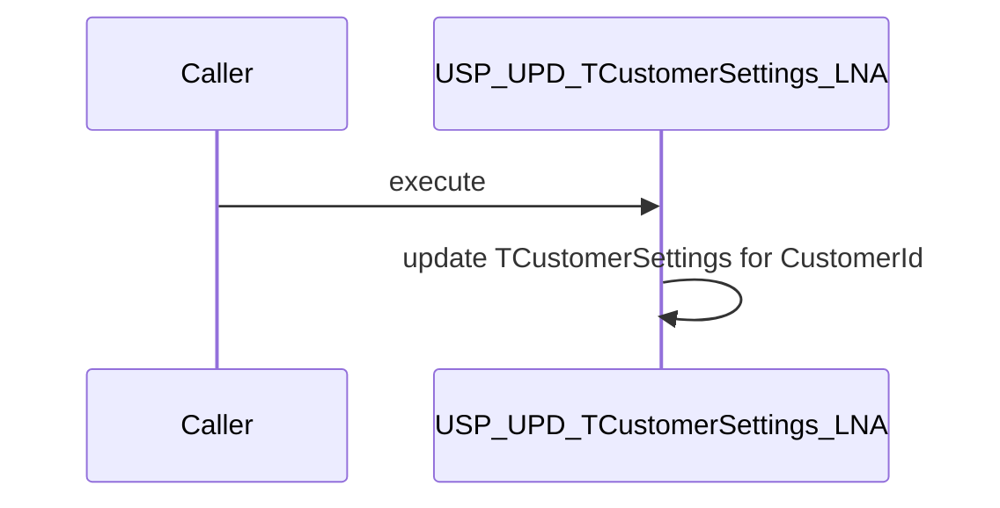
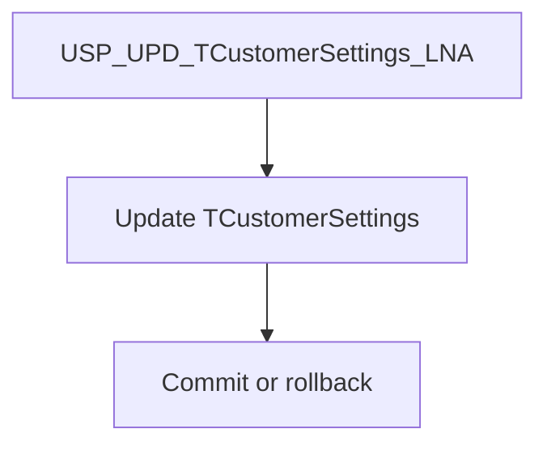

# USP_UPD_TCustomerSettings_LNA

## What it does

Updates leave and attendance configuration columns on `TCustomerSettings` for one customer (roster, payable days, geo tracking, risk policy JSON, attendance-card scopes, absentee notification, OT request mode, and related icons).

## Parameters

| Name | Direction | What it is for |
|---|---|---|
| `@CustomerId` | in | Customer number |
| `@IsShowShiftRoaster` | in | Show shift roster |
| `@IsPendingLeavesIncludeInPayableDays` | in | Pending leaves in payable days |
| `@ShowGeoTrackingReportonMap` | in | Geo tracking report on map |
| `@LeaveAttendanceRiskPolicySettings` | in | Risk policy JSON |
| `@AttendanceAdjustmentCriteria` | in | Attendance adjustment criteria |
| `@AttendanceAdjustmentHoursMode` | in | Attendance adjustment hours mode |
| `@ShiftOnEarlyShiftStartTime` | in | Shift on early start |
| `@ConsiderPunchesWithinShiftBracket` | in | Punches within shift bracket |
| `@UseEmployeeDefaultShiftIfRosterNotAssigned` | in | Default shift when no roster |
| `@ShowCheckInOutForAutoPresent` | in | Timing for auto present |
| `@IsOpeningBalanceAdjustmentEnabled` | in | Opening balance adjustment |
| `@IsPatternBasedRosterEnabled` | in | Pattern-based roster |
| `@WeeklySummaryCalculationScope` | in | Weekly summary scope |
| `@CalendarViewMode` | in | Calendar view mode |
| `@WeeklyOffScope` | in | Weekly-off scope |
| `@HolidayScope` | in | Holiday scope |
| `@LeaveScope` | in | Leave scope |
| `@IsShowHalfDayWeeklyOffInRoaster` | in | Half-day weekly off in roster |
| `@IsShowHalfDayHolidayInRoaster` | in | Half-day holiday in roster |
| `@UnfreezePolicy` | in | Unfreeze policy |
| `@IsLeaveLapseNotificationEnabled` | in | Leave lapse notification |
| `@DisplayShiftName` | in | Display shift name |
| `@DisplayPullbackIcon` | in | Display pullback icon |
| `@DisplayGroupName` | in | Display group name |
| `@DisplayLogInLogOutIcon` | in | Display login/logout icon |
| `@DisplayOverTimeIcon` | in | Display overtime icon |
| `@DisplayARIcon` | in | Display AR icon |
| `@DisplayPrecendenceRuleWOHOIcon` | in | Display precedence icon |
| `@IsStrictSinglePunchRule` | in | Strict single-punch rule |
| `@ShowWFHIconOnCalendar` | in | WFH icon on calendar |
| `@ShowODIconOnCalendar` | in | OD icon on calendar |
| `@ReportFilterOn` | in | Report filter on |
| `@AbsenteeNotificationTriggerMethod` | in | Absentee notification trigger |
| `@AbsenteeNotificationLookbackPeriod` | in | Absentee lookback period |
| `@AbsenteeNotificationThresholdDays` | in | Absentee threshold days |
| `@IsAbsenteeNotificationEnabled` | in | Absentee notification enabled |
| `@OTRequestMode` | in | OT request mode |
| `@IsCumilativeModeEnabled` | in | Cumulative mode enabled |

## Call sequence

## Callers

No other procedure or function calls this object. `UpdateSetupCustomerSetting` executes it when the Customer Config Setup Customer Setting tab maps to this procedure.

## Nested

Calls no other procedures or functions.

## Steps

1. In `HRMS-DATABASE/HRMS/STOREPROCEDURE/USP_UPD_TCustomerSettings_LNA.sql`, begin a transaction.
2. Update `TCustomerSettings` for `@CustomerId`, keeping existing values when a parameter is null (`COALESCE` / `ISNULL`).
3. Commit on success; roll back on error.

## Tables

| Table | Read or write |
|---|---|
| `dbo.TCustomerSettings` | write |

## Flow

