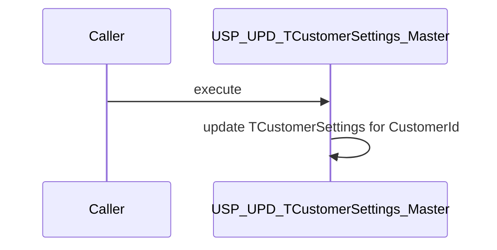
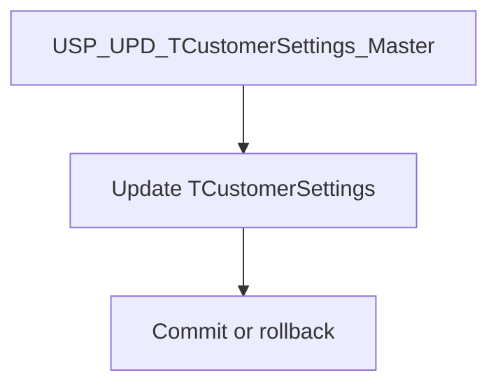

# USP_UPD_TCustomerSettings_Master

## What it does

Updates master and retirement-reminder columns on `TCustomerSettings` for one customer. When automatic reminders are enabled, it validates frequency, start days, specific days, weekday, and month-day against the alert window, then normalises unused frequency fields to null. Throws on validation failure.

## Parameters

| Name | Direction | What it is for |
|---|---|---|
| `@CustomerId` | in | Customer number |
| `@IsLevelMandatoryDesignation` | in | Level mandatory on designation |
| `@BusinessUnit` | in | Business unit label text |
| `@RetirementAge` | in | Retirement age |
| `@RetirementAlertBeforeMonths` | in | Legacy unused parameter |
| `@IsStrictSinglePunchRule` | in | Strict single-punch rule |
| `@RetirementAlertBeforeDays` | in | Alert window in days |
| `@IsRetirementReminderEnabled` | in | Send automatic reminders |
| `@RetirementReminderStartDays` | in | Start sending from days before |
| `@RetirementReminderFrequency` | in | One-Time Daily Weekly Monthly or Specific Days |
| `@RetirementReminderSpecificDays` | in | CSV of days for Specific Days |
| `@RetirementReminderWeekDay` | in | Weekly weekday 1-7 |
| `@RetirementReminderMonthDay` | in | Monthly day 1-31 |

## Call sequence

## Callers

No other procedure or function calls this object. `UpdateSetupCustomerSetting` executes it when the Customer Config Setup Customer Setting tab maps to this procedure.

## Nested

Calls no other procedures or functions.

## Steps

1. In `HRMS-DATABASE/HRMS/STOREPROCEDURE/USP_UPD_TCustomerSettings_Master.sql`, begin a transaction.
2. Update `TCustomerSettings` for `@CustomerId`, keeping existing values when a parameter is null (`COALESCE` / `ISNULL`).
3. Resolve effective reminder values with COALESCE against the existing row.
4. Validate reminder rules when enabled; THROW 50001 on failure.
5. Null out frequency fields that do not apply, then update the row.
6. Commit on success; roll back on error.

## Tables

| Table | Read or write |
|---|---|
| `dbo.TCustomerSettings` | read, write |

## Flow

