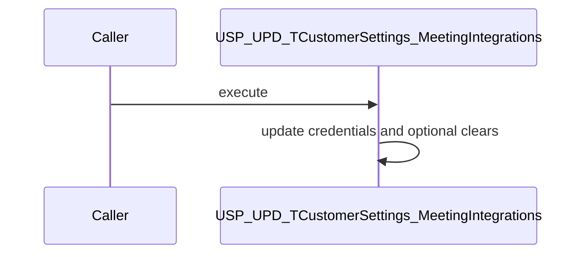
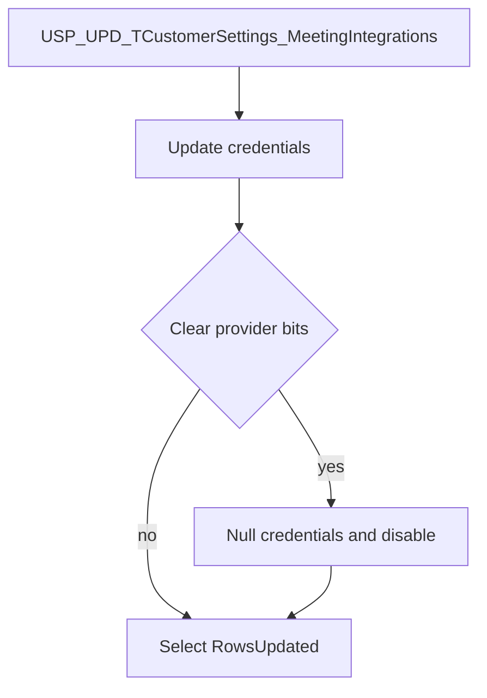

# USP_UPD_TCustomerSettings_MeetingIntegrations

## What it does

Updates Meeting Integrations credentials and enable flags on `TCustomerSettings` for one customer (Teams, Zoom, Google, LMS Teams). Null credential parameters keep stored values (`ISNULL`). Optional clear bits null out a provider's credentials and disable it. Returns `RowsUpdated` from the main update.

## Parameters

| Name | Direction | What it is for |
|---|---|---|
| `@CustomerId` | in | Customer number |
| `@MeetingTeamsClientId` | in | Teams client id |
| `@MeetingTeamsTenantId` | in | Teams tenant id |
| `@MeetingTeamsClientSecret` | in | Teams client secret |
| `@MeetingTeamsOrganizerEmail` | in | Teams organizer email |
| `@MeetingZoomAccountId` | in | Zoom account id |
| `@MeetingZoomClientId` | in | Zoom client id |
| `@MeetingZoomClientSecret` | in | Zoom client secret |
| `@MeetingGoogleServiceAccountJson` | in | Google service account JSON |
| `@MeetingGoogleImpersonatedUserEmail` | in | Google impersonated user email |
| `@MeetingTeamsEnabled` | in | Teams enabled |
| `@MeetingZoomEnabled` | in | Zoom enabled |
| `@MeetingGoogleEnabled` | in | Google enabled |
| `@LmsTeamsClientId` | in | LMS Teams client id |
| `@LmsTeamsTenantId` | in | LMS Teams tenant id |
| `@LmsTeamsClientSecret` | in | LMS Teams client secret |
| `@LmsTeamsOrganizerEmail` | in | LMS Teams organizer email |
| `@LmsTeamsEnabled` | in | LMS Teams enabled |
| `@MeetingTeamsVerifiedAt` | in | Teams verified at |
| `@MeetingZoomVerifiedAt` | in | Zoom verified at |
| `@MeetingGoogleVerifiedAt` | in | Google verified at |
| `@LmsTeamsVerifiedAt` | in | LMS Teams verified at |
| `@MeetingTeamsSecretExpiresAt` | in | Teams secret expiry |
| `@LmsTeamsSecretExpiresAt` | in | LMS Teams secret expiry |
| `@ClearMeetingTeamsSecretExpiry` | in | Clear Teams secret expiry |
| `@ClearLmsTeamsSecretExpiry` | in | Clear LMS Teams secret expiry |
| `@ClearMeetingTeams` | in | Clear Teams credentials |
| `@ClearMeetingZoom` | in | Clear Zoom credentials |
| `@ClearMeetingGoogle` | in | Clear Google credentials |
| `@ClearLmsTeams` | in | Clear LMS Teams credentials |
| `@ClearMeetingTeamsVerifiedAt` | in | Clear Teams verified at |
| `@ClearMeetingZoomVerifiedAt` | in | Clear Zoom verified at |
| `@ClearMeetingGoogleVerifiedAt` | in | Clear Google verified at |

## Call sequence

Calls no other procedures or functions.

## Callers

No other procedure or function calls this object. `UpdateSetupCustomerSetting` executes it when `tab` is `meetingIntegrations`.

## Nested

Calls no other procedures or functions.

## Steps

1. In `HRMS-DATABASE/HRMS/STOREPROCEDURE/USP_UPD_TCustomerSettings_MeetingIntegrations.sql`, update credential and enable columns for `@CustomerId`, refreshing `*UpdatedAt` when related fields are supplied.
2. Apply clear flags for verification timestamps and secret expiry when requested.
3. When a provider clear bit is set, null that provider's credentials, disable it, and stamp `UpdatedAt`.
4. Select `@@ROWCOUNT` as `RowsUpdated`.

## Tables

| Table | Read or write |
|---|---|
| `dbo.TCustomerSettings` | write |

## Flow

