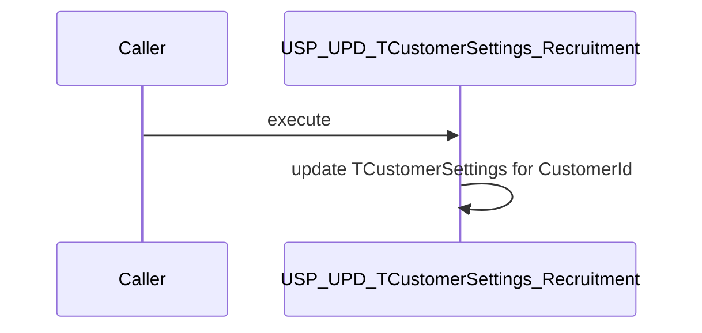
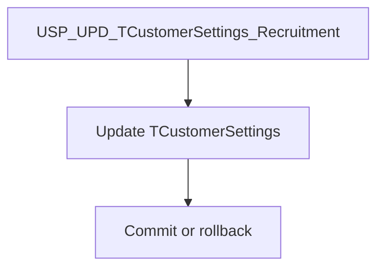

# USP_UPD_TCustomerSettings_Recruitment

## What it does

Updates recruitment feature flags on `TCustomerSettings` for one customer (donor details, offer-letter options, RRS / CTC / budget permissions, on-hold reminders, revised offer/hiring, workforce summary, meeting providers).

## Parameters

| Name | Direction | What it is for |
|---|---|---|
| `@CustomerId` | in | Customer number |
| `@IsDonorDetails` | in | Donor details |
| `@IsAddAdditionalCcInOfferLetter` | in | Additional CC on offer letter |
| `@IsRRSApprovedFromHiringManager` | in | RRS approved from hiring manager |
| `@IsOLForCandidatePasswordProtected` | in | Password-protected offer letter |
| `@IsViewCTCPermissions` | in | View CTC permissions |
| `@IsUseBudgetApproval` | in | Use budget approval |
| `@IsUseRecruitmentPermission` | in | Use recruitment permission |
| `@NumberOfOnHoldRemindersBeforeExpiry` | in | On-hold reminders before expiry |
| `@OnHoldActionReminders` | in | On-hold action reminders |
| `@IsAutoRRSCreationOnResignation` | in | Auto RRS on resignation |
| `@IsRevisedOffer` | in | Revised offer |
| `@IsRevisedHiring` | in | Revised hiring |
| `@IsEnabledWorkforceSummaryTable` | in | Workforce summary table |
| `@IsRecruitmentZoomMeetingEnabled` | in | Recruitment Zoom |
| `@IsRecruitmentGoogleMeetEnabled` | in | Recruitment Google Meet |
| `@IsRecruitmentMSTeamsEnabled` | in | Recruitment MS Teams |

## Call sequence

## Callers

No other procedure or function calls this object. `UpdateSetupCustomerSetting` executes it when the Customer Config Setup Customer Setting tab maps to this procedure.

## Nested

Calls no other procedures or functions.

## Steps

1. In `HRMS-DATABASE/HRMS/STOREPROCEDURE/USP_UPD_TCustomerSettings_Recruitment.sql`, begin a transaction.
2. Update `TCustomerSettings` for `@CustomerId`, keeping existing values when a parameter is null (`COALESCE` / `ISNULL`).
3. Commit on success; roll back on error.

## Tables

| Table | Read or write |
|---|---|
| `dbo.TCustomerSettings` | write |

## Flow

