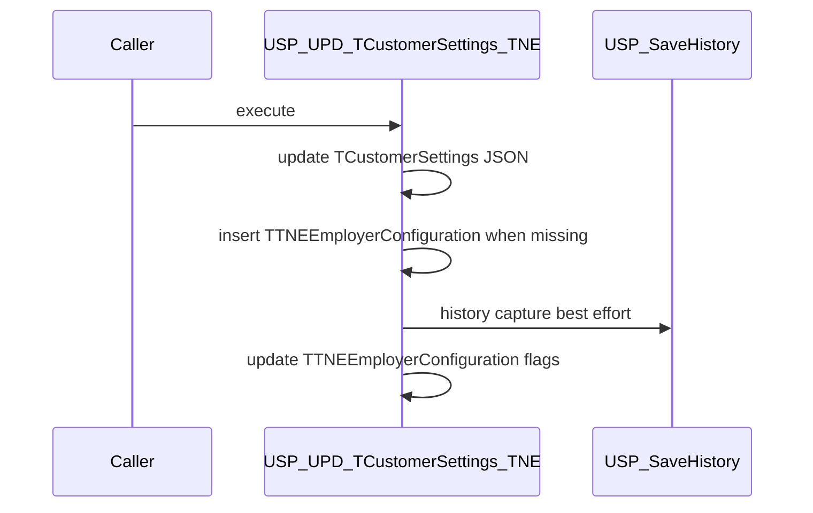
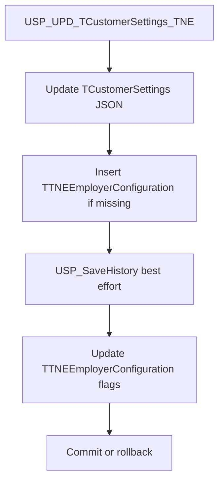

# USP_UPD_TCustomerSettings_TNE

## What it does

Updates Travel and Expense JSON columns on `TCustomerSettings` for one customer, ensures a `TTNEEmployerConfiguration` row exists for that employer, attempts a history capture through `USP_SaveHistory`, then updates T&E employer-configuration flags (purpose/comments, advance, travel report, expense windows, project formats, reschedule options). History failures are printed and do not block the settings update.

## Parameters

| Name | Direction | What it is for |
|---|---|---|
| `@CustomerId` | in | Customer number |
| `@TNEConfiguration` | in | Core T&E configuration JSON |
| `@ExpensePartOneTNEConfiguration` | in | Expense part-one JSON |
| `@WebExpensePartTwoTNEConfiguration` | in | Web expense part-two JSON |
| `@WebTravelTNEConfiguration` | in | Web travel JSON |
| `@WebOtherTNEConfiguration` | in | Web other JSON |
| `@TravelDeskEmail` | in | Travel desk email |
| `@IsMultipleWorkflow` | in | Multiple workflow flag |
| `@TravelTypeId` | in | Travel type id |
| `@ItineraryOptionMaxLimit` | in | Itinerary option max |
| `@RequestPurposeMandatory` | in | Request purpose mandatory |
| `@ApproverCommentMandatory` | in | Approver comment mandatory |
| `@RejectCommentMandatory` | in | Reject comment mandatory |
| `@SkipAcknowledgmentByAccountant` | in | Skip accountant acknowledgment |
| `@SkipAmountPaid` | in | Skip amount paid |
| `@CostEstimationEnable` | in | Cost estimation enabled |
| `@AdvanceEnabled` | in | Advance enabled |
| `@TravelReportEnabled` | in | Travel report enabled |
| `@BillToOption` | in | Bill-to option enabled |
| `@TravelReportSubmission` | in | Travel report submission |
| `@TravelReportSubmissionDeadline` | in | Travel report deadline |
| `@DefaultBillToOption` | in | Default bill-to |
| `@LoginEmployeeid` | in | Actor employee for history and audit columns |
| `@IsExpenseSubmissionWindowEnabled` | in | Expense submission window enabled |
| `@ExpenseSubmissionWindowPeriod` | in | Expense submission window period |
| `@IsCurrentMonthExpenseSubmissionAllowed` | in | Current-month expense submission |
| `@ExpenseDateLimit` | in | Expense date limit |
| `@ExpenseCutofftype` | in | Expense cutoff type |
| `@IsCostCenterEnabled` | in | Expense cost center enabled |
| `@IsExpenseProjectDetailsEnabled` | in | Expense project details enabled |
| `@ExpenseProjectDetailsFormat` | in | Expense project details format |
| `@CustomExpenseTypeEnabled` | in | Custom expense type enabled |
| `@IsReapplyExpenseEnabled` | in | Reapply expense enabled |
| `@MaxReapplyExpenseCount` | in | Max reapply expense count |
| `@TravelRescheduleType` | in | Travel reschedule type |
| `@IsTravelRescheduleAddNewScheduleEnabled` | in | Add new schedule on reschedule |
| `@TravelRescheduleInitiatorRouting` | in | Reschedule initiator routing |
| `@IsTravelRescheduleBookingPreferenceEnabled` | in | Booking preference on reschedule |
| `@TravelProjectDetailsFormat` | in | Travel project details format |
| `@ScheduleTripTypes` | in | Schedule trip types |
| `@ExpenseLineItemView` | in | Expense line item view |
| `@ExpenseAdvanceAssociationEnabled` | in | Expense-advance association |
| `@RestrictExpenseDatesToTravel` | in | Restrict expense dates to travel |

## Call sequence

## Callers

No other procedure or function calls this object. `UpdateSetupCustomerSetting` executes it when `tab` is `te`.

## Nested

| Object | Kind | When | Page |
|---|---|---|---|
| `USP_SaveHistory` | procedure | after ensuring employer config exists | unresolved in this checkout (no `HRMS/STOREPROCEDURE/USP_SaveHistory.sql`) |

## Steps

1. In `HRMS-DATABASE/HRMS/STOREPROCEDURE/USP_UPD_TCustomerSettings_TNE.sql`, resolve `@EmployerId` from `TCustomerSettings`.
2. Update T&E JSON columns on `TCustomerSettings`.
3. Insert a default `TTNEEmployerConfiguration` row when the employer has none.
4. Call `USP_SaveHistory` for `TTNEEmployerConfiguration`; catch and print errors without failing the batch.
5. Update `TTNEEmployerConfiguration` flag columns for the employer.
6. Commit or roll back the outer transaction.

## Tables

| Table | Read or write |
|---|---|
| `dbo.TCustomerSettings` | read, write |
| `dbo.TEmployerDetails` | read |
| `dbo.TTNEEmployerConfiguration` | read, write |

## Unresolved calls

- `USP_SaveHistory` — invoked with main/history table names for `TTNEEmployerConfiguration`, but the procedure body is not under `HRMS/STOREPROCEDURE` in this checkout.

## Flow

