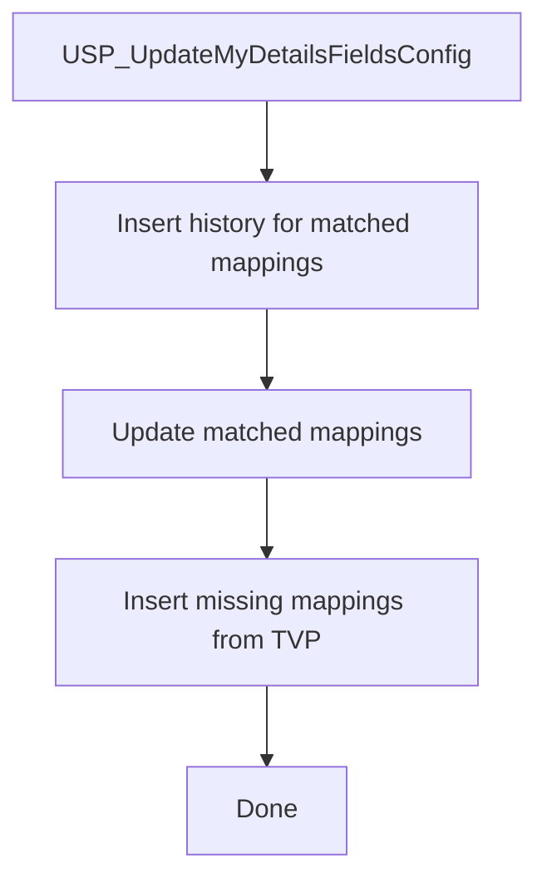

# USP_UpdateMyDetailsFieldsConfig

## What it does

Applies My Details field mandatory/hide settings from table-valued parameter `UDT_POBLookUp_FieldItems`. For matching active mapping rows it first writes a history snapshot (`Action` `Update`) with old and new mandatory/hide values, then updates `IsMandatory`, `IsHide`, `EffectiveFrom`, and audit columns. For TVP rows with no mapping yet it inserts a new `POBLookupEmployerMapping` row (flags for Pre-Onboarding and My Details set on).

## Parameters

| Name | Direction | What it is for |
|---|---|---|
| `@POBLookUpFields` | in | `UDT_POBLookUp_FieldItems` rows (`EmployerID`, `POBLookupID`, `POBLookupItemsID`, `IsMandatory`, `IsHide`) |
| `@EffectiveFrom` | in | Effective date written on update and insert |
| `@UpdatedBy` | in | Employee id for history and mapping audit columns |

## Call sequence

Calls no other procedures or functions.

## Callers

No other procedure or function calls this object. Application caller: Core API `preOnBoardingDAL._UpdateLookupItems` inside `UpdateLookupItems` (once per employer in a transaction).

## Nested

Calls no other procedures or functions.

## Steps

1. Script is `HRMS-DATABASE/HRMS/STOREPROCEDURE/USP_UpdateMyDetailsFieldsConfig.sql`.
2. Insert into `POBLookupEmployerMapping_History` from existing `POBLookupEmployerMapping` rows joined to `@POBLookUpFields`, copying current values and setting new mandatory/hide values plus `HistoryCreatedBy` / `HistoryCreatedOn`.
3. Update matching `POBLookupEmployerMapping` rows with TVP `IsMandatory`, `IsHide`, `@EffectiveFrom`, `@UpdatedBy`, and `UpdatedDtm`.
4. Insert missing mapping rows by joining the TVP to `POBLookupItems` where no mapping exists; set `IsActive = 1`, `IsPreOnboarding = 1`, `IsMyDetails = 1`.

## Tables

| Table | Read or write |
|---|---|
| `dbo.POBLookupEmployerMapping` | read, write |
| `dbo.POBLookupEmployerMapping_History` | write |
| `dbo.POBLookupItems` | read |

## Flow

