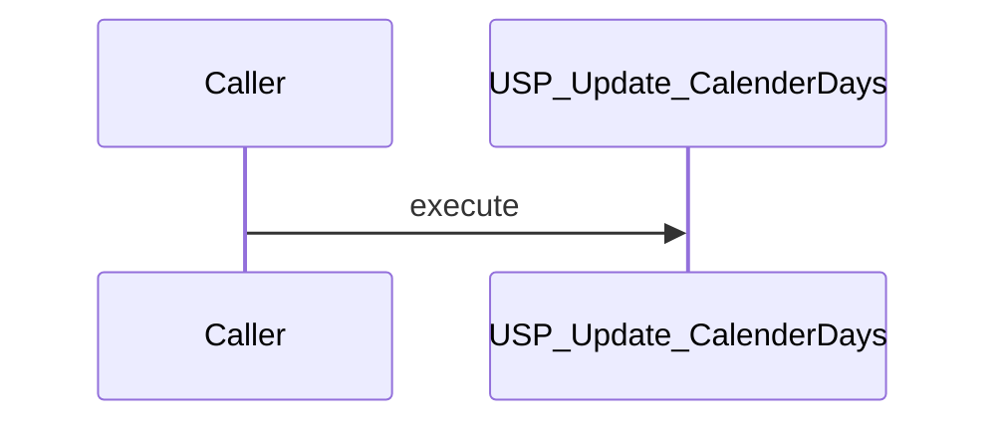
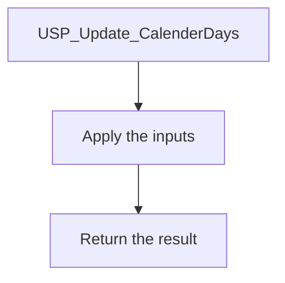

# USP_Update_CalenderDays

## What it does

Called from the Home dashboard path. It changes TCalenderDays, TC and returns the result to its caller.

## Parameters

| Name | Direction | What it is for |
|---|---|---|
| `@Year` | in | Year for the attendance or timesheet card (`INT`) |

## Call sequence

## Callers

| Object | Kind | Page |
|---|---|---|
| `SP_DB_EmployeeAttendanceDetails` | procedure | [SP_DB_EmployeeAttendanceDetails](/docs/database/hrms/SP_DB_EmployeeAttendanceDetails) |
| `SP_DB_EmployeeAttendanceFromEmailDetails` | procedure | No page yet |
| `SP_GetEmployeeWeeklyOffDays` | procedure | No page yet |
| `USP_LA_Validate_Leave_FromToDate` | procedure | No page yet |

## Nested

This object does not execute another procedure or user-defined function.

## Steps

In `HRMS-DATABASE/HRMS/STOREPROCEDURE/USP_Update_CalenderDays.sql`:

1. Write `TCalenderDays`, `TC`.
2. Return the result set to the caller.

## Tables

| Table | Read or write |
|---|---|
| `TCalenderDays` | read and write |
| `TC` | write |

## Flow

