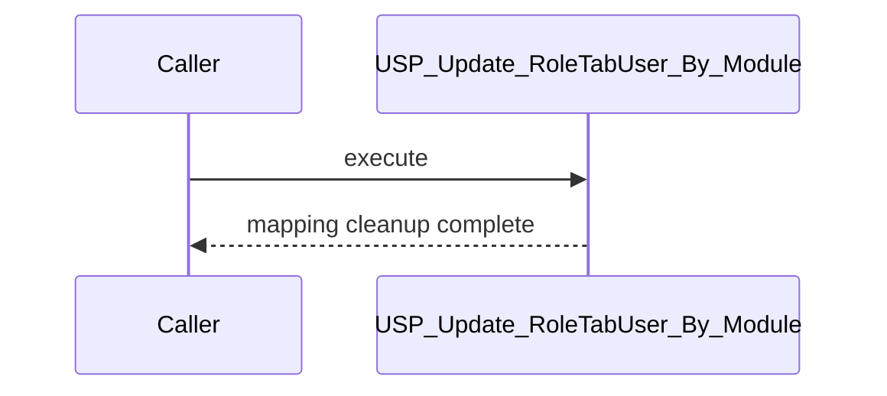
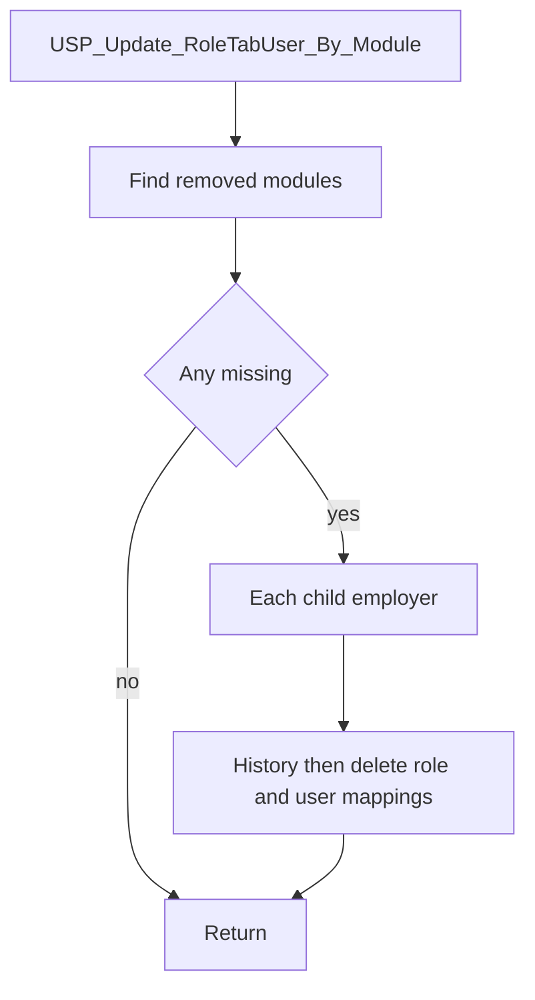

# USP_Update_RoleTabUser_By_Module

## What it does

On licence update, finds modules that were previously licensed for the root employer but are missing from the new module CSV, then for every active employer under that root removes role/user page and tab mappings tied to those modules (after writing history rows).

## Parameters

| Name | Direction | What it is for |
|---|---|---|
| `@RootEmployerID` | in | Root employer id (licence employer) |
| `@ModuelIDs` | in | New comma-separated module ids |
| `@CreatedBy` | in | Actor for history inserts |

## Call sequence

## Callers

Called only from `USP_TLicence_SaveUpdate` on the update path.

## Nested

None.

## Steps

1. Load existing `TEmployerModule` module ids for `@RootEmployerID` and the new CSV into table variables; compute missing modules.
2. When missing modules exist, loop each active employer under that root.
3. For each employer, history-then-delete `TRolePagesMapping` / `TRoleTabDetails` and matching user page/tab mappings linked through module menu/tab mappings for the missing modules.

## Tables

| Table | Read or write |
|---|---|
| `dbo.TEmployerModule` | read |
| `dbo.TEmployerDetails` | read |
| `dbo.TRoles` | read |
| `dbo.TRolePagesMapping` | read, write |
| `dbo.TRolePagesMappingHistory` | write |
| `dbo.TRoleTabDetails` | read, write |
| `dbo.tMenuDetails` | read |
| `dbo.TModuleMenuMapping` | read |
| `dbo.TTabDetails` | read |
| `dbo.TTabModuleMapping` | read |
| User page/tab mapping tables in the remainder of the script | read, write |

## Unresolved calls

None.

## Flow

