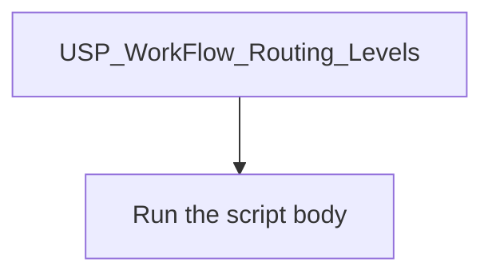

# USP_WorkFlow_Routing_Levels

## What it does

Resolves the managers for each level of a workflow definition and returns them for the request being routed. Confirmation reassignment calls it after changing the approver.

## Parameters

| Name | Direction | What it is for |
|---|---|---|
| `@wfId` | in | Wf Id. Default 935 |
| `@lv_RequestOwner` | in | Lv Request Owner. Default 4632 |
| `@Employerid` | in | Employerid. Default 10 |
| `@RequestTransid` | in | Request Transid. Default NULL |
| `@RequestType` | in | Request Type. Default NULL |
| `@CandidateMappingId` | in | Candidate Mapping Id. Default NULL |

## Call sequence

Calls no other procedures or functions.

## Callers

| Object | Kind | Page |
|---|---|---|
| `SP_AdminCMS_UpdReassignManager` | procedure | [SP_AdminCMS_UpdReassignManager](/docs/database/hrms/SP_AdminCMS_UpdReassignManager) |
| `SP_ADMINPMS_EmployeeGoalApproveWF` | procedure | No page yet |
| `SP_AdminPMS_InsEmpGoalSettingMapping` | procedure | No page yet |
| `SP_AdminPMS_OnDemandGoalInitiate` | procedure | No page yet |
| `SP_AdminPMS_UpdEmployeeGoalFormDataSubmit` | procedure | No page yet |
| `SP_AdminPMS_UpdGoalInitiate` | procedure | No page yet |
| `SP_AdminPMS_UpdReassignGoalManager` | procedure | No page yet |
| `SP_AdminPMS_UpdReassignManager` | procedure | No page yet |
| `SP_CM_ApproveWorkFlowRequest` | procedure | No page yet |
| `SP_CM_ApproveWorkFlowRequest_240624` | procedure | No page yet |
| `SP_CM_ApproveWorkFlowRequestBKP03052025` | procedure | No page yet |
| `SP_CM_ApproveWorkFlowRequestbkp21032024` | procedure | No page yet |
| `SP_CMS_GetCompetencyforConfirmation` | procedure | No page yet |
| `Sp_CMS_InsertEmployeeConfirmation` | procedure | No page yet |
| `SP_CMS_UpdEmpConfirmationDueDate` | procedure | No page yet |
| `SP_CMS_UpdEmpConfirmationRatings` | procedure | No page yet |
| `Sp_GetWhatsAppNotificationDetails` | procedure | No page yet |
| `SP_PMS_GetCompetencyforSelfAppraisal` | procedure | No page yet |
| `SP_PMS_InsEmpGoalMappingForNewJoinees` | procedure | No page yet |
| `SP_PMS_UpdEmpAppraisalRatings` | procedure | No page yet |
| `SP_PMS_UpdEmployeeGoalFormDataSubmit_WithoutTag` | procedure | No page yet |
| `SP_PMS_UpdSalaryRevForEmployeeAssessment` | procedure | No page yet |
| `SP_PMS_UPDSalaryRevisionForMoreInfo` | procedure | No page yet |
| `SP_RRS_GetApprovalLevel` | procedure | No page yet |
| `USP_LeaveRequest_Notification_ModalView` | procedure | No page yet |

## Nested

Calls no other procedures or functions.

## Steps

Script: `HRMS-DATABASE/HRMS/STOREPROCEDURE/USP_WorkFlow_Routing_Levels.sql`.

1. SELECT @IsPreviousActionApprover = IsPreviousActionApprover
2. SELECT DISTINCT @BusinessUnitId = EI.BusinessUnitId
3. SELECT b.employeeid
4. SELECT max(bh.OrgBusinessHeadId)
5. SELECT IsSelfassessmentIsRequired
6. SELECT DISTINCT @ReportsTo = ReportsTo
7. SELECT DISTINCT *
8. SELECT DISTINCT WD.*
9. if(@RequestType in ( 'SelfAssessment','EmployeeGoalSetting','ConfirmationAssessment') )
10. SELECT @XMLString = CAST(REPLACE(WorkflowDefinitionTree, '<?xml version="1.0" encoding="utf-16"?>', '') AS XML)
11. INSERT INTO @TableName (
12. SELECT Node.value('(Node/@Text[1])[1]', 'VARCHAR(500)') AS P1

## Tables

| Table | Read or write |
|---|---|
| `TCustomerSettings` | read |
| `TEmployeeOrgBusinessHead` | read |
| `temployerdetails` | read |
| `TEmployeeInfo` | read |
| `TORGChart` | read |
| `TWorkflowDetails` | read |
| `TWorkflowManagement` | read |
| `TRequestReRouteLog` | read |
| `TRequestReRouteLogDetail` | read |
| `tRoleEmployeeMapping` | read |
| `tRoleBusinessUnitMapping` | read |
| `tRoleLocationMapping` | read |
| `TRoles` | read |
| `TUserEmployee` | read |
| `TUsers` | read |
| `TRRSCandidateInterview` | read |
| `TRRSDetails` | read |
| `TRRStransactionDetails` | read |
| `TRecruiter` | read |
| `TRRSCandidateMapping` | read |
| `TRequestWorkflows` | read |

## Flow

