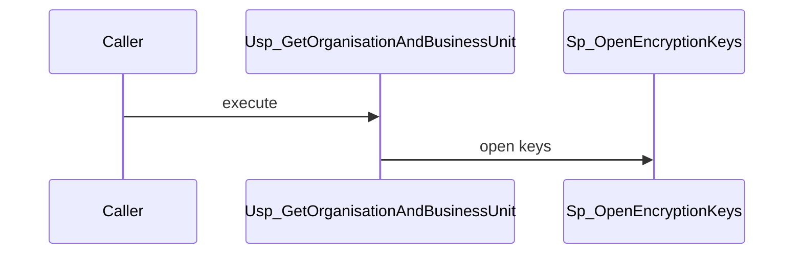
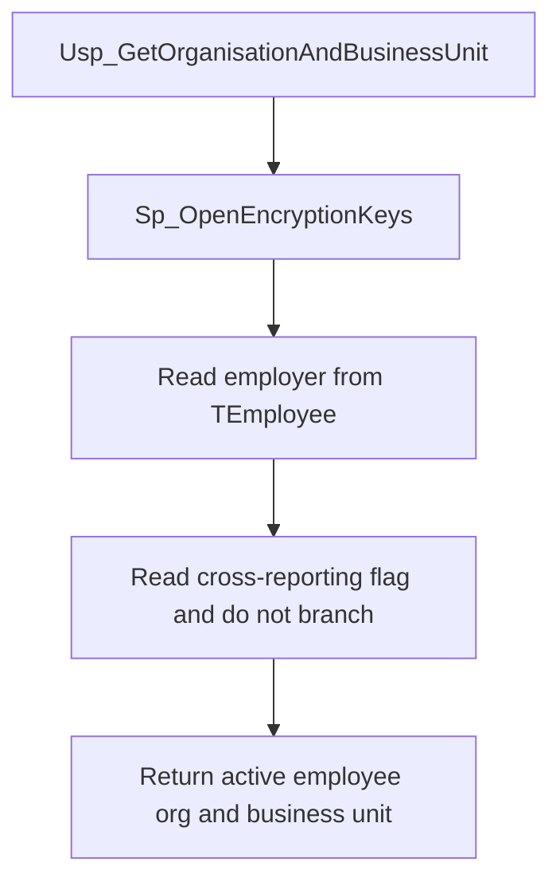

# Usp_GetOrganisationAndBusinessUnit

## What it does

Returns the employer and business unit of one active employee. View Organization Chart uses the first row to preselect the organization and business unit, and to label that business unit when it is missing from the business-unit list.

The procedure reads `IsCrossreportingApplicable` and then ignores it. The `IF` that would branch on that flag is commented out, so the select always runs.

## Parameters

| Name | Direction | What it is for |
|---|---|---|
| `@EmployeeId` | in | Employee to look up. Declared `varchar(50)`. The API passes an int |

## Call sequence

There is no matching close in this procedure. The select does not read an encrypted column.

## Callers

| Object | Kind | Page |
|---|---|---|
| `dashBoardDAL.GetOrganizationAndBusinessUnit` | app | [View Organization Chart](/docs/guides/admin-configuration/view-organization-chart) |
| `dashBoardDAL.GetOrgAndBU` | app | `GET /api/dashBoard/GetOrgAndBU`. The V2 screen does not call that route |
| `managementDashboardDAL.GetOrgAndBU` | app | Management dashboard filters |
| `dashBoardDAL_V2.GetOrganizationAndBusinessUnit` and `GetOrgAndBU` | app | V2 DAL. `routeIndex.js` does not mount `DashBoardRoutes_V2.js` for this path |
| `dashBoardDAL_V3.GetOrganizationAndBusinessUnit` and `GetOrgAndBU` | app | V3 DAL. Same mount note |

No other procedure in `STOREPROCEDURE/` executes it.

## Nested

| Object | Kind | When | Page |
|---|---|---|---|
| `Sp_OpenEncryptionKeys` | procedure | Always, before the selects | [Sp_OpenEncryptionKeys](/docs/database/hrms/Sp_OpenEncryptionKeys) |

## Steps

In `HRMS-DATABASE/HRMS/STOREPROCEDURE/Usp_GetOrganisationAndBusinessUnit.sql`:

1. Execute `Sp_OpenEncryptionKeys`.
2. Read `EmployerId` from `Temployee` for `@EmployeeId` into `@OrganizationID`.
3. Read `IsCrossreportingApplicable` from `tEmployerdetails` for that employer. The following branch is commented out.
4. Return `OrganizationID`, `OrganizationName`, `BusinessUnitId`, and `BusinessUnit` for `TEmployee` rows with `EmployeeId = @EmployeeId` and `IsActive = 'Y'`.
5. `OrganizationID` and `OrganizationName` come from `TEmployerDetails` through `TEmployeeInfo.EmployerID`.
6. `BusinessUnit` is `TOrgHierarchyDetails.UnitName` for `TEmployeeInfo.BusinessUnitId` and the same employer.

## Tables

| Table | Read or write |
|---|---|
| `dbo.Temployee` / `dbo.TEmployee` | read |
| `dbo.tEmployerdetails` / `dbo.TEmployerDetails` | read |
| `dbo.TEmployeeInfo` | read |
| `dbo.TOrgHierarchyDetails` | read |

## Flow

