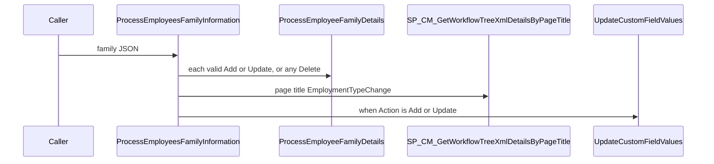
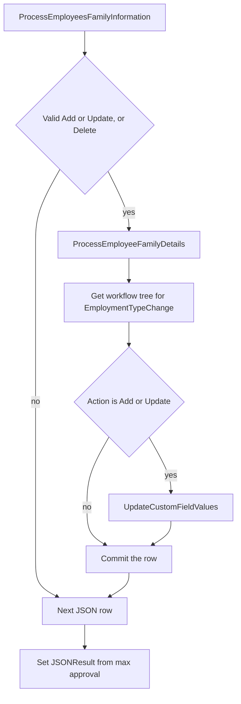

# Usp_Mydetails_Enhanced_ProcessEmployeesFamilyInformation

## What it does

Walks each JSON family row. For an Add or Update that is marked valid, or for any Delete, it processes that row inside `DML_FAMILY_OPERATION`. Add sets `@IsOverride` to 0. After a successful Add it replaces the family id with the latest change-request id or the latest `TEmployeeFamilyDetails` id, then updates custom fields. The output bit is the maximum `approval` value collected in `#Approval`.

## Parameters

| Name | Direction | What it is for |
|---|---|---|
| `@EmployerID` | in | Employer for the family and custom-field work |
| `@EmployeeData` | in | JSON array of family rows |
| `@FieldList` | in | Comma-separated fields to apply |
| `@IsOverride` | in | Overwritten per row from `Action` |
| `@UpdatedBy` | in | User performing the change |
| `@CountryID` | in | Country passed to the row processor |
| `@SectionID` | in | Family Details section id |
| `@JSONResult` | out | `1` when any collected approval flag is set |

## Call sequence

## Steps

1. Open a cursor over `OPENJSON(@EmployeeData)` and read `ID`, `EmployeeFamilyDetailID`, `isValid`, and `Action` (`STOREPROCEDURE/Usp_Mydetails_Enhanced_ProcessEmployeesFamilyInformation.sql`).
2. Skip the row unless `isValid` is true and `Action` is Update or Add, or `Action` is Delete.
3. Reject a null `Action`. Set override to 1 for Update and Delete, and to 0 for Add.
4. Execute `SP_Mydetails_Enhanced_ProcessEmployeeFamilyDetails` and insert its result into `#Approval`.
5. Execute `SP_CM_GetWorkflowTreeXmlDetailsByPageTitle` for `EmploymentTypeChange`. When a workflow exists and the employee is the updater, take the latest unapproved new `TEmployeeFamilyDetails` change request. Otherwise take the latest `EmployeeFamilyDetailID` for that employee.
6. On Add, replace the in-memory family id with that value.
7. On Add or Update, execute `SP_Mydetails_Enhanced_UpdateCustomFieldValues` using the transaction id from `#Approval` as the custom-field id.
8. Commit the row. On failure, roll back, log `TSQL_Errorlogs`, and later `RAISERROR` the unprocessed-record message.
9. After the cursor, raise the first non-empty `#Approval` message, then set `@JSONResult` from the maximum approval flag.

## Tables

| Table | Read or write |
|---|---|
| `#Approval` | write |
| `#TotalRecords` | write |
| `#tmpFlowDetails` | write |
| `dbo.TMyDetailsChangeRequestDetails` | read |
| `dbo.TMyDetailsChangeRequests` | read |
| `dbo.TEmployeeFamilyDetails` | read |
| `dbo.TSQL_Errorlogs` | write |

## Procedures and functions it calls

| Object | Kind | When | Page |
|---|---|---|---|
| `SP_Mydetails_Enhanced_ProcessEmployeeFamilyDetails` | procedure | each processed row | [SP_Mydetails_Enhanced_ProcessEmployeeFamilyDetails](/docs/database/hrms/SP_Mydetails_Enhanced_ProcessEmployeeFamilyDetails) |
| `SP_CM_GetWorkflowTreeXmlDetailsByPageTitle` | procedure | after each processed row | [SP_CM_GetWorkflowTreeXmlDetailsByPageTitle](/docs/database/hrms/SP_CM_GetWorkflowTreeXmlDetailsByPageTitle) |
| `SP_Mydetails_Enhanced_UpdateCustomFieldValues` | procedure | Action is Add or Update | [SP_Mydetails_Enhanced_UpdateCustomFieldValues](/docs/database/hrms/SP_Mydetails_Enhanced_UpdateCustomFieldValues) |

## Flow

