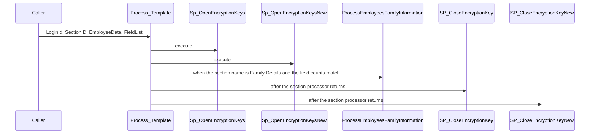
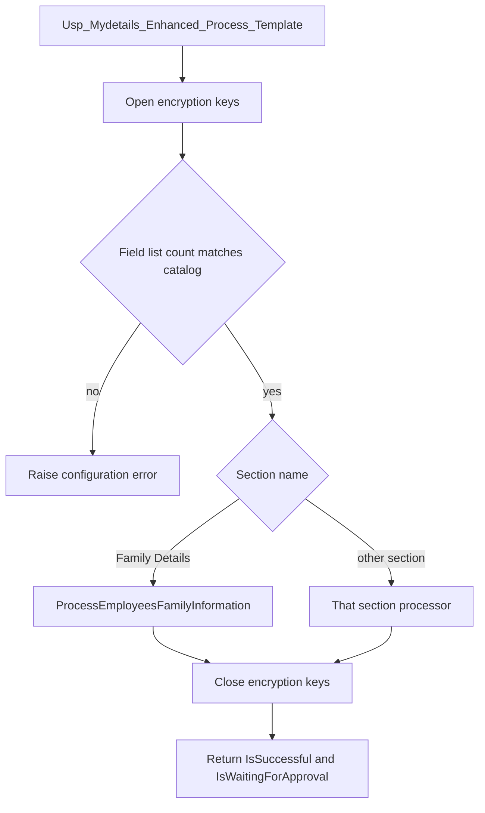

# Usp_Mydetails_Enhanced_Process_Template

## What it does

Accepts a My Details section id and a JSON array of rows, checks that the submitted field list matches the active visible fields for that section, then runs the section processor whose name matches `TEmployeeDetail_Section`. For Family Details it calls `Usp_Mydetails_Enhanced_ProcessEmployeesFamilyInformation`. It opens the encryption keys before the section work and closes them after a successful try. A field-count mismatch raises an error and skips every section processor.

## Parameters

| Name | Direction | What it is for |
|---|---|---|
| `@LoginId` | in | Logged-in user. Also used as `@UpdatedBy`. The employee id is read from `JSON_VALUE` of `$[0].ID` |
| `@SectionID` | in | `TEmployeeDetail_Section` id. Family Details is section 10 |
| `@EmployeeData` | in | JSON array of section rows |
| `@FieldList` | in | Comma-separated display texts the caller says it sent |

## Call sequence

Other section names call their own processors. Those branches are listed below and are not on the add-family request.

## Callers

No other procedure or function calls this object.

## Nested

| Object | Kind | When | Page |
|---|---|---|---|
| `Sp_OpenEncryptionKeys` | procedure | always, before the section branch | [Sp_OpenEncryptionKeys](/docs/database/hrms/Sp_OpenEncryptionKeys) |
| `Sp_OpenEncryptionKeysNew` | procedure | always, before the section branch | [Sp_OpenEncryptionKeysNew](/docs/database/hrms/Sp_OpenEncryptionKeysNew) |
| `Usp_Mydetails_Enhanced_ProcessEmployeesFamilyInformation` | procedure | section name is Family Details | [Usp_Mydetails_Enhanced_ProcessEmployeesFamilyInformation](/docs/database/hrms/Usp_Mydetails_Enhanced_ProcessEmployeesFamilyInformation) |
| `SP_CloseEncryptionKey` | procedure | after the matching section processor | [SP_CloseEncryptionKey](/docs/database/hrms/SP_CloseEncryptionKey) |
| `SP_CloseEncryptionKeyNew` | procedure | after the matching section processor | [SP_CloseEncryptionKeyNew](/docs/database/hrms/SP_CloseEncryptionKeyNew) |
| `Usp_Mydetails_Enhanced_UpdateEmployeeDetails` | procedure | section name is Personal Details | |
| `Usp_Mydetails_Enhanced_ProcessEmployeesSkillsInformation` | procedure | section name is Skill Details | |
| `Usp_Mydetails_Enhanced_ProcessEmployeesDomainInformation` | procedure | section name is Domain Details | |
| `Usp_Mydetails_Enhanced_UpdateEmployeePassportInformation` | procedure | section name is Passport Details | |
| `Usp_Mydetails_Enhanced_UpdateEmployeeVisaInformation` | procedure | section name is Visa Details | |
| `Usp_Mydetails_Enhanced_ProcessEmployeesPastEmploymentInformation` | procedure | section name is Past Employment Details | |
| `Usp_Mydetails_Enhanced_ProcessEmployeesBankDetailInformation` | procedure | section name is Bank Details | |
| `Usp_Mydetails_Enhanced_ProcessEmployeesEducationInformation` | procedure | section name is Education Details | |
| `Usp_Mydetails_Enhanced_ProcessEmployeesNominationInformation` | procedure | section name is Nomination Details | |
| `Usp_Mydetails_Enhanced_ProcessEmployeesNomineeInformation` | procedure | section name is Nominee Details | |
| `Usp_Mydetails_Enhanced_ProcessEmployeesContactInformation` | procedure | section name is Contact Details | |
| `Usp_Mydetails_Enhanced_ProcessEmployeesEmergencyContactInformation` | procedure | section name is Emergency Contact Details | |
| `Usp_Mydetails_Enhanced_ProcessEmployeesCertificationInformation` | procedure | section name is Certification Details | |
| `Usp_Mydetails_Enhanced_UpdateCurrentEmploymentDetails` | procedure | section name is Current Employment Details | |
| `Usp_Mydetails_Enhanced_UpdateAdditionalInfo` | procedure | section name is Additional Info | |

## Steps

1. Read the employee id from the first JSON object (`STOREPROCEDURE/Usp_Mydetails_Enhanced_Process_Template.sql`).
2. Open both encryption-key procedures.
3. Load employer and country of employment from `Temployee`.
4. Count active, visible, non-deleted fields for the section. Nomination adds 2 to that count and Nominee adds 1. Family Details uses the raw count.
5. When the split `@FieldList` count equals that field count, enter the try block and run the matching section processor. Family Details runs `Usp_Mydetails_Enhanced_ProcessEmployeesFamilyInformation`.
6. Close both encryption-key procedures and return `IsSuccessful = 1` plus `IsWaitingForApproval` from the section processor output.
7. On error, insert `TSQL_Errorlogs` and `RAISERROR` the message.
8. When the field counts differ, `RAISERROR` that the field configuration changed.

## Tables

| Table | Read or write |
|---|---|
| `dbo.Temployee` | read |
| `dbo.Temployeedetail_fields` | read |
| `dbo.TEmployeeDetail_Section` | read |
| `dbo.TSQL_Errorlogs` | write |

## Flow

