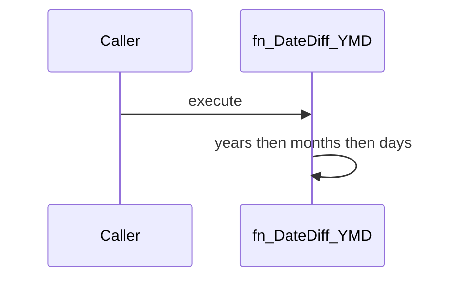
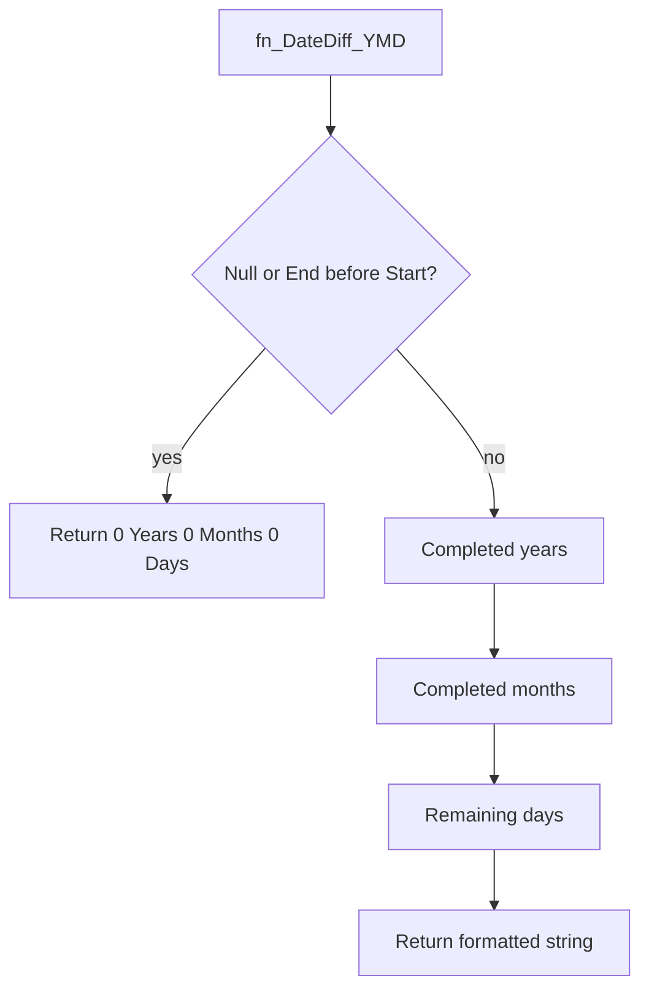

# fn_DateDiff_YMD

## What it does

Scalar function that formats the calendar difference between two dates as `"N Years N Months N Days"`. Used by `SP_Employer_LicenseDashboard` for Passed, Remaining, and Expired duration columns. Returns `'0 Years 0 Months 0 Days'` when either argument is null or `@EndDate < @StartDate`.

## Parameters

| Name | Direction | What it is for |
|---|---|---|
| `@StartDate` | in | Interval start |
| `@EndDate` | in | Interval end |

## Call sequence

Calls no other procedures or functions.

## Callers

| Object | Kind | Page |
|---|---|---|
| `SP_Employer_LicenseDashboard` | procedure | [SP_Employer_LicenseDashboard](/docs/database/hrms/SP_Employer_LicenseDashboard) |

## Nested

None.

## Steps

1. Guard nulls and inverted range.
2. Compute completed years with a `DATEADD` overshoot correction.
3. Compute completed months from the year-adjusted base the same way.
4. Remaining days via `DATEDIFF(DAY, …)`.
5. Concatenate and return the three parts.

## Tables

None.

## Unresolved calls

None.

## Flow

