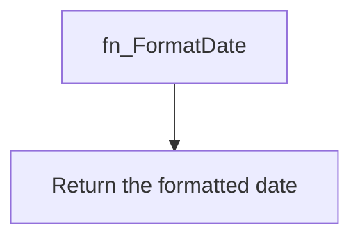

# fn_FormatDate

## What it does

Formats a datetime with one of eight format ids. An unknown id uses style 106 with slashes replaced by dashes.

## Parameters

| Name | Direction | What it is for |
|---|---|---|
| `@InputDate` | in | Date to format |
| `@DateFormatId` | in | Format id from 1 to 8 |

## Call sequence

Calls no other procedures or functions.

## Callers

Procedures and functions that call this object.

| Object | Kind | Page |
|---|---|---|
| `SP_GetEmpDocGeneratedDetails` | procedure | No page yet |
| `SP_GetEmployeeLetterDetails` | procedure | [SP_GetEmployeeLetterDetails](/docs/database/hrms/SP_GetEmployeeLetterDetails) |
| `Sp_TnE_InsertTravelRequestWithPref` | procedure | No page yet |

## Nested

Calls no other procedures or functions.

## Steps

1. Choose the format for `@DateFormatId` and return the formatted string (`fn_FormatDate.sql`).

## Tables

No table is read or written.

## Flow

