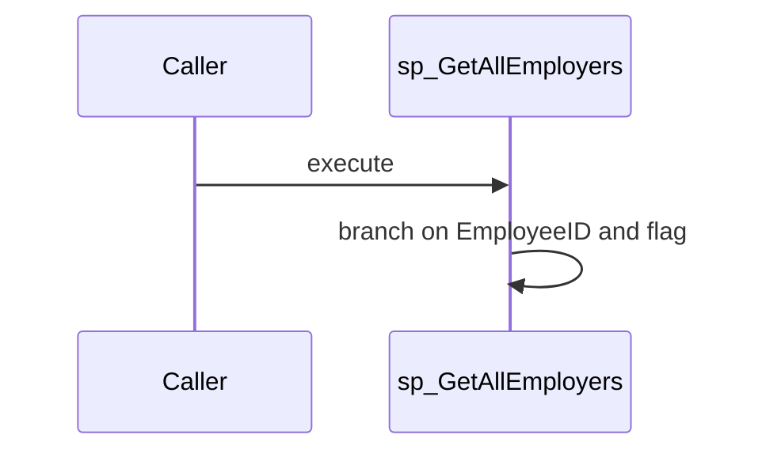
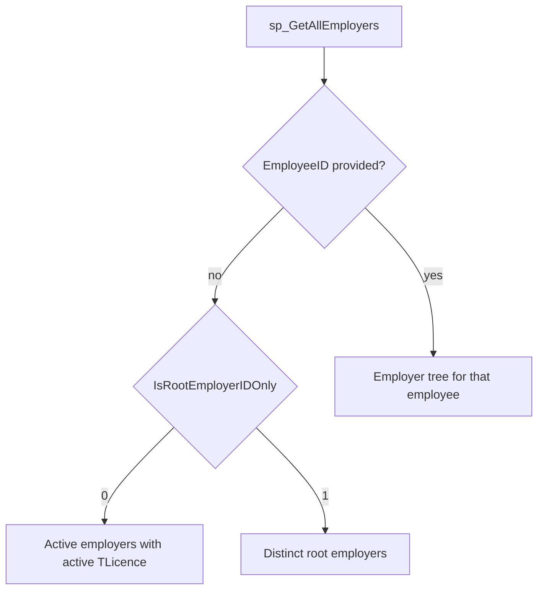

# sp_GetAllEmployers

## What it does

Returns employer rows for organisation pickers. When `@EmployeeID` is null or negative and `@IsRootEmployerIDOnly = 0` (the Customer License Dashboard Module Usage path with `superId` undefined → 0), it returns every active employer that has an active `TLicence` on its root, with `EmployerName` optionally suffixed by `custid`. Other branches return root-only lists or the caller's allowed employer tree when `@EmployeeID` is supplied.

## Parameters

| Name | Direction | What it is for |
|---|---|---|
| `@IsRootEmployerIDOnly` | in | `0` all licensed actives; `1` distinct roots only (when employee id absent) |
| `@EmployeeID` | in | Optional; scopes to that employee's employer tree when positive |

## Call sequence

Calls no other procedures or functions.

## Callers

| Object | Kind | Page |
|---|---|---|
| `dashBoardDAL.GetAllEmployers` | app | [Customer License Dashboard](/docs/guides/customer-license/customer-license-dashboard) (Module Usage org tree); many other screens |

## Nested

None.

## Steps

1. If `@EmployeeID` is null/negative and flag is 0, select active `TEmployerDetails` joined to active `TLicence` on `RootEmployerId`.
2. If flag is 1, return distinct active root employers.
3. If `@EmployeeID` is provided, resolve that employee's employer and return the allowed employer set for that context (remaining branches in the script).

## Tables

| Table | Read or write |
|---|---|
| `dbo.TEmployerDetails` | read |
| `dbo.TLicence` | read (all-employers branch) |
| `dbo.TEmployee` | read (employee-scoped branches) |

## Unresolved calls

None.

## Flow

