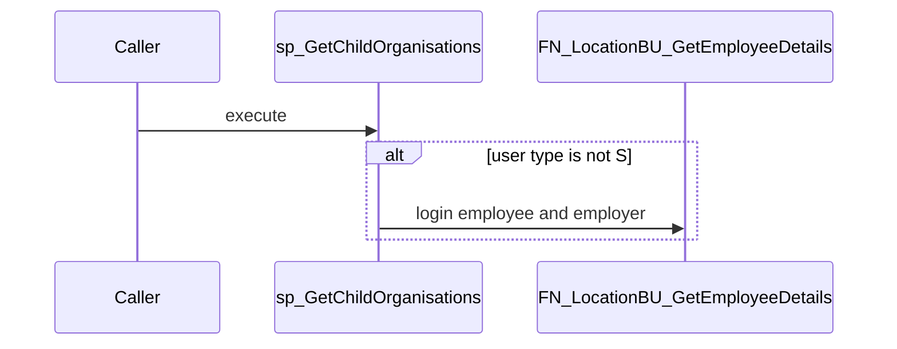
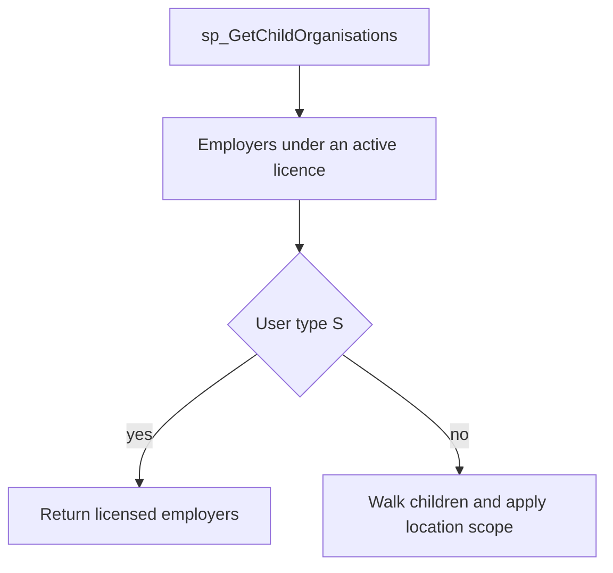

# sp_GetChildOrganisations

## What it does

Returns organisations for a parent combo. Superadmin user type S lists every active, not-deleted employer under an active licence. Every other user type walks the child tree from @EmployerId and keeps rows that FN_LocationBU_GetEmployeeDetails returns and that sit under an active licence.

## Parameters

| Name | Direction | What it is for |
|---|---|---|
| `@EmployerId` | in | Starting employer for the non-superadmin tree |
| `@UserType` | in | S takes the full licensed list |
| `@LoginEmployeeId` | in | Passed to the location and business-unit function. Default null. Add Organization does not send it |

## Call sequence

## Callers

Procedures and functions that call this object.

No other procedure or function calls this object.

## Nested

| Object | Kind | When | Page |
|---|---|---|
| `FN_LocationBU_GetEmployeeDetails` | function | user type is not S | [FN_LocationBU_GetEmployeeDetails](/docs/database/hrms/FN_LocationBU_GetEmployeeDetails) |

## Steps

1. Collect employer ids whose root has an Active TLicence.

2. When @UserType is S, return active, not-deleted employers in that set, with the customer number appended to the name.

3. Otherwise walk non-deleted children from @EmployerId and keep a row only when both the licence set and FN_LocationBU_GetEmployeeDetails contain that employer.

## Tables

| Table | Read or write |
|---|---|
| `TLicence` | read |
| `TEmployerDetails` | read |

## Flow

