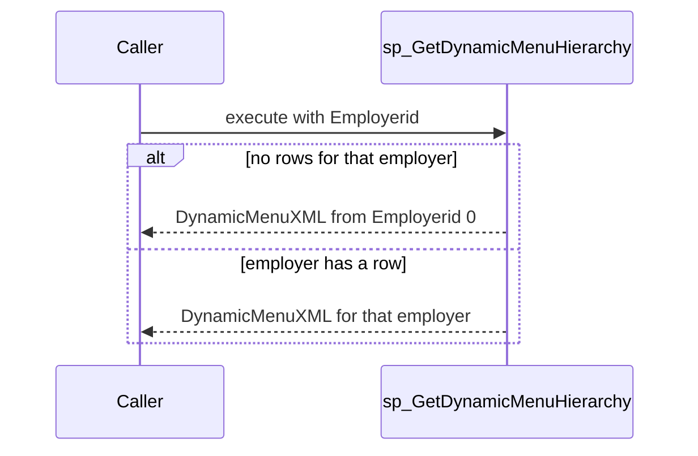
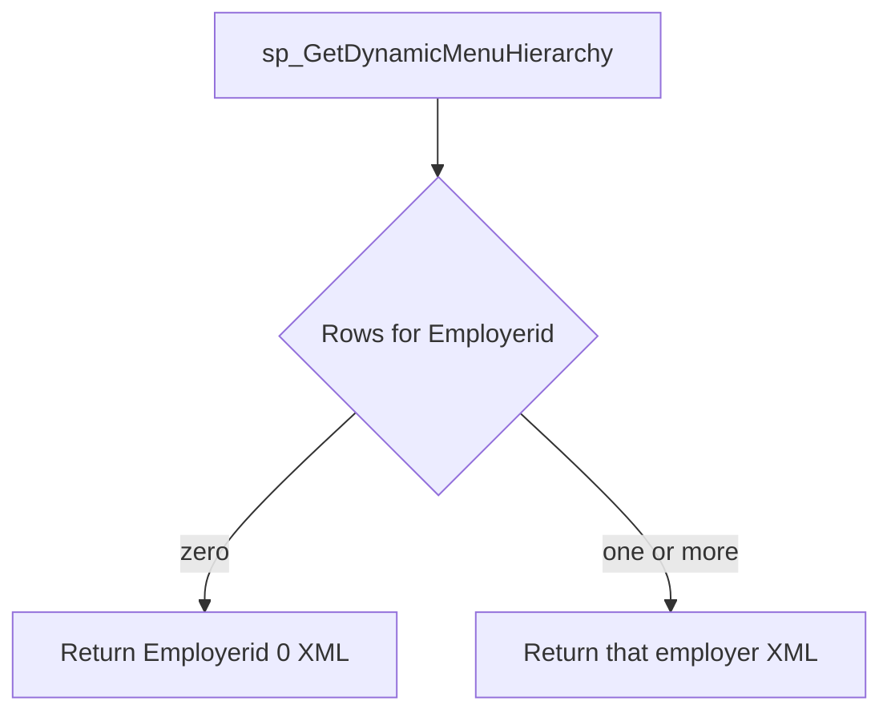

# sp_GetDynamicMenuHierarchy

## What it does

Returns the dynamic left-nav XML for one employer. When that employer has no `TDynamicMenuHierarchy` row, it returns the base organisation row (`Employerid` 0) instead.

Menu Manager always calls it with `EmployerId` 0 to load the editable base tree. Apply-only also uses it to read the base XML before copying to other organisations.

## Parameters

| Name | Direction | What it is for |
|---|---|---|
| `@Employerid` | in | Employer whose menu XML to read |

## Call sequence

## Callers

No other procedure or function calls this object. `MenuManagerDAL.fetchOrganizationMenuTree` executes it for Menu Manager (`GET /api/menuManagement/baseOrganizationMenuTree` and apply-only copy).

## Nested

Calls no other procedures or functions.

## Steps

1. In `HRMS-DATABASE/HRMS/STOREPROCEDURE/sp_GetDynamicMenuHierarchy.sql`, count `TDynamicMenuHierarchy` rows for `@Employerid`.
2. When the count is 0, select `DynamicMenuXML` and `Transid` where `Employerid` is 0.
3. Otherwise select `DynamicMenuXML` and `Transid` where `employerid` equals `@Employerid`.

## Tables

| Table | Read or write |
|---|---|
| `dbo.TDynamicMenuHierarchy` | read |

## Unresolved calls

None.

## Flow

