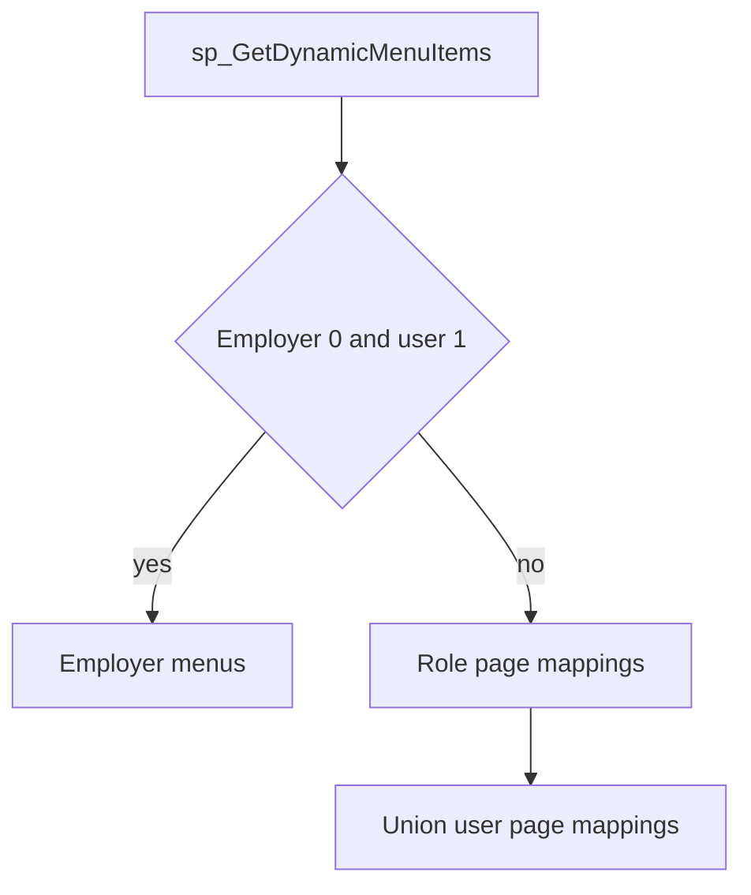

# sp_GetDynamicMenuItems

## What it does

Returns the menu rows a user may open for an employer: menu id, name, parent, URL, page name, icon, and parent sequence. Email Template Builder uses the URL to decide whether the signed-in user may stay on the page. User 1 on employer 0 gets the menus stored for that employer. Everyone else gets menus mapped through their role and through `TUSerPagesMapping`. For role 4, the Recruitment menu URL is replaced with the Candidate Referral URL.

## Parameters

| Name | Direction | What it is for |
|---|---|---|
| `@UserId` | in | User whose menus are loaded |
| `@Employerid` | in | Organisation on the user, role mapping, and menu rows |

## Call sequence

Calls no other procedures or functions.

## Callers

No other procedure or function calls this object.

`DashboardDAL.GetMenuItems` calls it. Email Template Builder reaches that method from `Page_Load`.

## Nested

Calls no other procedures or functions.

## Steps

1. When `@Employerid` is 0 and `@UserId` is 1, select menus from `TUsers`, `TMenuHierarchy`, and `tMenuDetails` for that user and employer, `MenuID` greater than 1, and `isactive` = 1 (`sp_GetDynamicMenuItems.sql`).
2. Union menus for that employer that are not tied to the user row. Order by `parentseq`.
3. Otherwise join `TUsers` to `TRolePagesMapping`, `TMenuHierarchy`, and `tMenuDetails` on role, page, and employer.
4. When `RoleID` is 4 and the menu name is Recruitment, use the first `tMenuDetails.NavigateURL` whose name is Candidate Referral.
5. Union rows from `TUSerPagesMapping` for the same user and employer, with the same Recruitment replacement. Order by `parentseq`.

## Tables

| Table | Read or write |
|---|---|
| `TUsers` | read |
| `TMenuHierarchy` | read |
| `tMenuDetails` | read |
| `TRolePagesMapping` | read |
| `TUSerPagesMapping` | read |

## Flow

