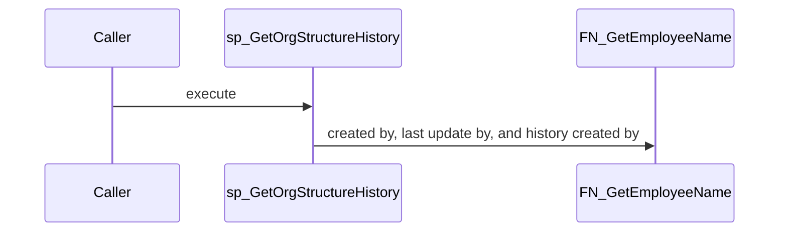
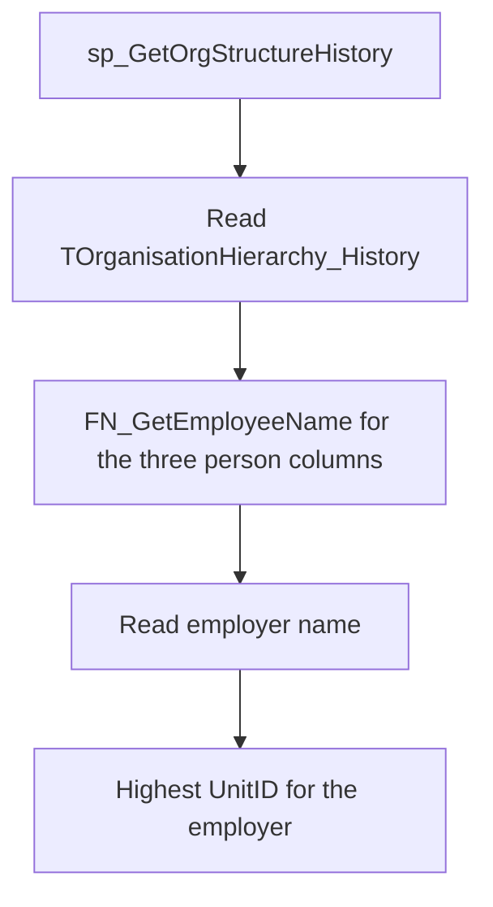

# sp_GetOrgStructureHistory

## What it does

Returns chart history for one employer from `TOrganisationHierarchy_History`. Each row includes the stored XML, who created and last updated the chart, who wrote the history row, the action, the employer name, and the highest `UnitID` currently on `torghierarchydetails`. A commented block above the live select would also have read `TOrganisationHierarchy`. That block is not executed. The live update procedure `USP_AdminORG_UpdOrgHierarchy` does not insert into this history table.

## Parameters

| Name | Direction | What it is for |
|---|---|---|
| `@EmployerId` | in | Employer whose history rows and current max unit id are read |

## Call sequence

## Callers

No other procedure or function calls this object. View Organization BU History calls it through `CommonDAL.GetOrgStructureHistory`.

## Nested

| Object | Kind | When | Page |
|---|---|---|---|
| `FN_GetEmployeeName` | function | created-by, last-update-by, and history-created-by columns | [Fn_GetEmployeeName](/docs/database/hrms/Fn_GetEmployeeName) |

## Steps

In `HRMS-DATABASE/HRMS/STOREPROCEDURE/sp_GetOrgStructureHistory.sql`:

1. Select history rows for `@EmployerId` from `TOrganisationHierarchy_History`.
2. Resolve `CreatedBy`, `LastUpdateBy`, and `HistoryCreatedBy` with [Fn_GetEmployeeName](/docs/database/hrms/Fn_GetEmployeeName).
3. Read `EmployerName` from `TEmployerDetails` for `@EmployerId`.
4. `HistoryCreatedDate` uses `ISNULL` to an empty string.
5. `LastNodeValue` is `TOP 1 UnitID` from `torghierarchydetails` for the employer, ordered by `UnitID` descending.
6. The commented union against `TOrganisationHierarchy` is not part of the live statement.

## Tables

| Table | Read or write |
|---|---|
| `dbo.TOrganisationHierarchy_History` | read |
| `dbo.TEmployerDetails` | read |
| `dbo.torghierarchydetails` | read |

## Flow

