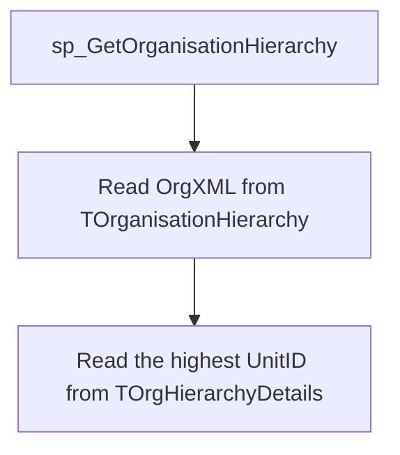

# sp_GetOrganisationHierarchy

## What it does

Returns the organisation chart XML for one employer, plus the highest `UnitID` currently stored for that employer. Policy Documents Setup loads the XML into the business-unit tree used by the exclusion list. The script has no header comment.

`CommonDAL.GetOrgStructureXml` calls this. The page reaches it through `CommonBLL.GetOrgStructureXml`.

## Parameters

| Name | Direction | What it is for |
|---|---|---|
| `@Employerid` | in | Employer whose chart is read. |

## Call sequence

Calls no other procedures or functions.

## Callers

No other procedure or function calls this object. `CommonDAL.GetOrgStructureXml` executes it. Policy Documents Setup uses the XML for the business-unit exclusion tree.

## Nested

Calls no other procedures or functions.

## Steps

1. In `HRMS-DATABASE/HRMS/STOREPROCEDURE/sp_GetOrganisationHierarchy.sql`, select `OrgXML` and `Transid` from `TOrganisationHierarchy` where `Employerid` is `@Employerid`.
2. `LastNodeValue` is `TOP 1 UnitID` from `torghierarchydetails` for the same employer, ordered by `UnitID` descending.
3. There is no active or deleted filter on either table. More than one hierarchy row for the employer returns more than one result row. The page reads `OrgXML` from the first row.

Neither `TOrganisationHierarchy` nor `TOrgHierarchyDetails` declares a foreign key. `TOrgHierarchyDetails.ParentUnitid` is not declared against `UnitID`.

## Tables

| Table | Read or write |
|---|---|
| `dbo.TOrganisationHierarchy` | read |
| `dbo.TOrgHierarchyDetails` | read |

## Flow

