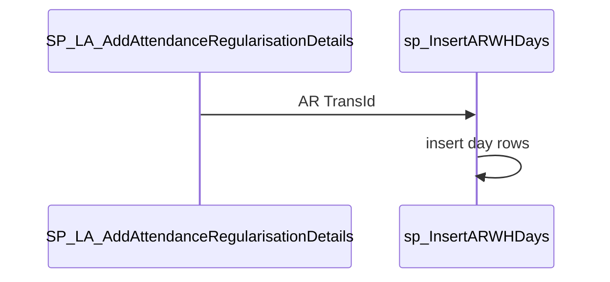
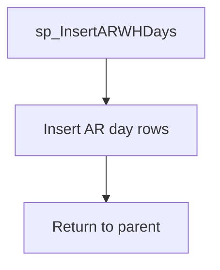

# sp_InsertARWHDays

## What it does

Materializes per-day child rows for an Attendance Regularization (and related AR/WH day) request after the parent AR insert creates `@lv_Transid`.

## Parameters

| Name | Direction | What it is for |
|---|---|---|
| Parent passes AR trans id | in | New AR request id (see script) |

## Call sequence

## Callers

| Object | Kind | Page |
|---|---|---|
| `SP_LA_AddAttendanceRegularisationDetails` | procedure | [SP_LA_AddAttendanceRegularisationDetails](/docs/database/hrms/SP_LA_AddAttendanceRegularisationDetails) |

## Nested

Calls no further procedures for the common path.

## Steps

1. Accept AR transaction id from parent.
2. Insert day-level AR child rows for the request range.

## Tables

| Table | Read or write |
|---|---|
| AR day child table(s) | write |
| `TAttendanceRegularization` | read |

## Unresolved calls

None.

## Flow

